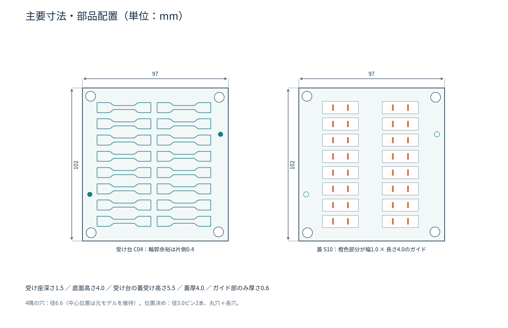

# 7号形・1.0 mm試料用 標線付け治具

完成したPME試料を無理に押し込まずに置き、長手方向と直角な2本の標線を、中心間10 mmで案内するための試作CADです。指定ペンはゼブラ マッキーペイントマーカー 極細 P-YYTS20-W（白、呼び線幅0.7 mm）です。ペンの軸径は固定せず、先端を動かす長穴で案内します。

**最初は小さい試し嵌め片とペン溝確認片だけを印刷してください。実際の試料寸法・プリンタの収縮・ペン先形状を未測定のため、現物での嵌合や標線精度は未検証です。**



[寸法と使い方（PDF）](./寸法と使い方.pdf)

## ファイルと初期選択

単位は全てmmです。STEPはネイティブなソリッド形状で、FusionなどのCADで開けます。STLは各部品を造形時の基準位置に置いて出力しています。

| ファイル | 用途 |
|---|---|
| STEP/fit_coupon.step、STL/fit_coupon.stl | 試し嵌め片。片側の輪郭余裕0.2／0.4／0.6 mmを比較。最初に印刷。 |
| STEP/pen_slot_coupon.step、STL/pen_slot_coupon.stl | ペン溝確認片。溝幅0.8／0.9／1.0／1.1／1.2／1.4 mmを比較。最初に印刷。 |
| STEP/base_C04.step、STL/base_C04.stl | 基本の受け台。輪郭余裕は片側0.4 mm。 |
| STEP/base_C02.step、STL/base_C02.stl | 余裕が小さい受け台。片側0.2 mm。 |
| STEP/base_C06.step、STL/base_C06.stl | 余裕が大きい受け台。片側0.6 mm。 |
| STEP/lid_S10.step、STL/lid_S10.stl | 基本の蓋。標線ガイド溝幅1.0 mm。 |
| STEP/lid_S12.step、STL/lid_S12.stl | ペン先が基本溝に入らない場合の代替蓋。溝幅1.2 mm。 |
| STEP/assembly_C04_S10.step | 基本の受け台＋基本蓋の組立STEP。位置関係の確認用。2個のソリッドを含む。 |
| parameters.json | 設計寸法・前提。 |
| source/build_jig.py、source/source_profile_edges.json | 寸法変更・再生成用のCadQueryスクリプトと元輪郭データ。 |
| verification.json | 形状検査、STEP再読込、干渉確認の結果。 |

## 元モデルから継承した内容

添付の2つのF3Dアーカイブを展開し、ASM境界形状から輪郭・配置を読み取りました。Fusionの履歴を直接編集したファイルではなく、読み取った輪郭を使って再構築した新規STEPです。

- 外形97 × 102 mm。
- 試料配置は2列 × 8行の16個。長手方向はX方向。
- 試料の元輪郭は長さ約35 mm、つかみ部幅約6 mm、平行部幅約2 mm、平行部長さ約12 mm。曲線も元形状から復元しています。
- 4隅の穴の中心位置は元モデルから継承し、穴径を6.6 mmにしています。元の穴位置は完全な対称長方形ではないため、読み取った実際の位置を維持しています。
- 元の試料輪郭そのものは拡大していません。**受け台の逃げだけを外側へオフセット**しています。

## 主な変更

### 幅・長さが合わず引っかかる問題

基本受け台C04では、試料輪郭の片側へ0.4 mmの逃げを設けています。受け座の最大長さは約35.8 mm、つかみ部の幅は約6.8 mm、平行部の幅は約2.8 mmです。入口上部の0.3 mmには、さらに片側0.25 mm広がる導入部を設けています。

底面は平らで、試料の全体を支えます。完成試料を伸ばしたり、肩部を押し込んだりして収納しないでください。逃げが大きいほど位置決めの遊びも増えるため、**無理なく平らに置ける範囲で最も小さい逃げ**を選び、両端・左右の隙間が均等になるよう中心を合わせます。

| 受け台 | 片側逃げ | 最大長さ | つかみ部幅 | 平行部幅 |
|---|---:|---:|---:|---:|
| C02 | 0.2 | 約35.4 | 約6.4 | 約2.4 |
| C04 | 0.4 | 約35.8 | 約6.8 | 約2.8 |
| C06 | 0.6 | 約36.2 | 約7.2 | 約3.2 |

現物の形状変化がこれ以上の場合は、押し込まず、試料の長さ・つかみ部幅・平行部幅を測って再調整してください。

### 蓋から標線を引く構造

各受け座の中央からX方向に±5 mmの位置へ、Y方向の長穴を配置しています。2本のガイド中心間はCAD上で10.0 mmです。

- 基本溝：幅1.0 mm × 全長4.0 mm。代替溝：幅1.2 mm × 全長4.0 mm。
- ガイド部分の厚さ：0.6 mm。上側は24 × 8.2 mmのアクセス用くぼみです。
- 蓋全体の厚さ：4.0 mm。ペンの軸は穴で締め付けません。
- 受け座の深さ：1.5 mm。公称1.0 mm厚の試料では、蓋下面まで0.5 mmの隙間があります。1.2 mm厚の試料でも設計上0.3 mmの隙間を残します。
- ペン先が届くには、薄肉部0.6 mmと試料上の隙間を越えて先端を出せる必要があります。ペン先の実形状は未測定なので、現物で必ず確認してください。

1.2 mm溝はペン先の通りやすさを優先する代替です。溝が広いほど線位置の遊びも増えます。まずは確認片で、引っ掛からず動かせる最も狭い溝を選んでください。

## 位置合わせと蓋の支持

受け台に直径3.0 mm・突出2.5 mmの位置決めピンを2本設け、蓋には直径3.4 mmの丸穴と、幅3.4 mm・全長4.6 mmの長穴を設けています。丸穴＋長穴で、印刷誤差による2本ピンの過拘束を抑えています。ピン先端には導入用のテーパーがあります。

蓋は受け台の周囲に載り、試料は押さえません。通常の標線付けではピンで位置を合わせて静かに置きます。必要な場合だけ外周を軽く固定し、反りやガタつきで蓋が試料を圧迫していないか確認してください。

## 印刷と使い方

1. 試し嵌め片を底面を下にして印刷します。3個のくぼみに完成試料を置き、平らに収まり、無負荷で出し入れできるものを選びます。印刷後のバリや糸引きも確認します。
2. ペン溝確認片を底面を下にして印刷し、実際のペン先が無理なく通る溝を探します。この部品は通り幅の確認用です。実使用時の到達距離は、別途0.5 mm程度の隙間を再現した端材、または組立治具で確認します。
3. 選んだ受け台と蓋を印刷します。どちらも平らな下面を下にします。受け台の位置決めピンは上向き、蓋の広いくぼみも上向きです。組立STEPをそのまま一体で印刷しないでください。
4. FDMを想定した初期目安はノズル0.4 mm・積層0.2 mm以下です。0.6 mmの薄肉部がスライサーで欠落しないこと、細い溝が塞がれないことを確認します。支持材を溝の中へ生成するとペンの通りを損なうことがあるため、スライス結果を見て判断してください。機種・材料に対する造形精度は未検証です。
5. 試料を無負荷で受け台の中央へ置きます。片側に寄ったままや、反ったまま蓋を載せないでください。
6. ペンのインク出しは端材で済ませます。試料上でペン先を強く押してインクを出さないでください。
7. 蓋を置き、2本の長穴に沿って軽い力で標線を付けます。インクのにじみ・付着・剥離を端材で確認してください。塗膜が太い場合でも、線の中心を追跡する測定方法は別途検証が必要です。
8. 蓋を外し、乾燥後に実際の標線中心間距離と中央からの対称性を撮影して確認します。線幅・筆圧・乾燥による個体差は、穴だけではゼロにできません。

## JISとの関係と精度

JIS K 6251:2017の表1の7号形の初期標線間距離10±0.5 mmと、箇条11の無負荷・直角・中央から等距離という配置を狙った治具です。**CAD上の溝間隔10.0 mmが、印刷後・マーキング後の実測精度やJISへの適合を保証するものではありません。**

造形後にガイド中心間隔を測り、端材に引いた標線の中心間距離が10±0.5 mmへ入ることを確認してください。必要な画像計測精度は、静止動画や既知変位による校正で別途確認します。この治具は試験片の作製法、材料へのインクの影響、力計測、試験速度、ヤング率やポアソン比の測定精度を認証するものではありません。

## CADで確認したこと

- 各部品が有効な単一ソリッドであること。
- STEPへ書き出して再読込しても体積とmm単位の外形寸法が保たれること。
- 基本組立における受け台と蓋の体積干渉がないこと。
- 16個の公称試料輪郭・厚さ1.2 mmが、受け台と蓋へ体積干渉しないこと。
- 32本のガイド溝が開通し、その両側の壁と中央の薄肉部が存在すること。
- 印刷用STLの全7部品について、閉じたメッシュであること（境界エッジ・非多様体エッジともゼロ、頂点統合許容差0.00001 mm）。

現物での造形・嵌合・筆圧・インク接触・標線精度の検証は行っていません。詳細な数値はverification.jsonを参照してください。

## 再生成

`source/build_jig.py`の辞書Pが設計寸法です。CadQuery 2.7以降とNumPyを使い、次で再生成できます。

```
python source/build_jig.py --output ./regenerated
```

parameters.jsonは生成時の寸法記録です。再生成時に寸法を変更する場合は、Python側の辞書Pを変更してください。輪郭を復元したsource_profile_edges.jsonはスクリプトと同じ場所へ置きます。
