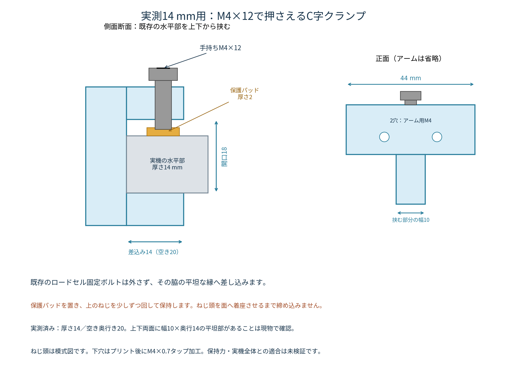

> **旧版・取付方向が不適合**：この版は赤丸部分の上下面を挟む構成でした。ユーザーの取付可否の確認により、50 mm離れた側面を挟む[最新版S50](../tensile-sync-side-clamp-s50-m4x12/README.md)へ変更しています。新規製作には最新版を使ってください。

# 厚さ14 mmの水平部へ取り付ける、M4×12のみの同期目印ホルダ

いただいた写真と実測値（水平部厚さ14 mm、挟める平坦部の奥行き20 mm）を基に、**水平部の縁を挟むC字クランプ式**へ変更しました。柱の裏へ結束バンドを回す必要はありません。既存のロードセル固定ボルトは外しません。

締結・押さえねじは、**すべてM4×12 mm、合計13本**です。ナット、インサート、座金、結束バンドは不要です。写真のすりわり付き小ねじのような平らな座面を想定しています。皿ねじ用の座面はありません。

**プリント後にM4×0.7のタップ加工が必要です。** STEP/STLには径3.3 mmの下穴を設けており、ねじ山は直接造形しません。

- [右側用Rの組立STEP](STEP/assembly_R.step) / [左側用Lの組立STEP](STEP/assembly_L.step)
- [14 mmの局所形状に取り付けたクランプ参考STEP](STEP/clamp_R_T14_REFERENCE.step)
- [M4×12を含む参考STEP](STEP/assembly_R_with_M4x12_REFERENCE.step)
- [取付け・組立ガイドPDF](assembly_guide.pdf)
- [取付け断面図PDF](mounting_detail.pdf)
- [部品別STEP](STEP/) / [印刷用STL](STL/)

GitHubのファイル画面で「Download raw file」を選ぶとダウンロードできます。組立STEPを一体で印刷せず、RかLのどちらか一式の部品別STLを使ってください。

## 写真を踏まえた取付方式

ロードセルの中央固定ボルトを避けた、水平部の前方の縁へ差し込みます。下のジョーを水平部の下面へ掛け、上のM4×12で保護パッドを押して保持します。金属へねじ先端を直接当てません。

| 項目 | 今回の設計 |
|---|---|
| 対象の厚さ | 実測14 mm |
| 挟む開口 | 18 mm（厚さ14＋パッド2＋差込み用の余裕2） |
| 差込み深さ | 14 mm。実測した空き20 mmに対し6 mmの余裕 |
| ジョー幅 | 10 mm |
| 保護パッド | 樹脂8×8×2 mm、中央にねじ先端を受ける浅いくぼみ |
| 台座前面 | 幅44 mm。下部は10 mm幅に絞り、ロードセル脇へ差し込みやすくした形状 |
| 圧力ねじ | 手持ちのM4×12を1本。樹脂へのねじ係合長さ8 mm |

確認が必要なのは、縁に**幅10×奥行14 mm以上の平坦部が上下両面にあり、クランプを差し込める空間があること**です。幅10 mmは未測定の設計条件です。ロードセル本体、既存ボルト・座金、配線を挟み込まない位置を選びます。

クランプ本体は全て可動ブラケット側に取り付けます。固定柱・ガイド・リミット部品には接触させません。写真だけで実機の全形状を復元したものではありません。

## 最初に印刷するもの

まず、01クランプ本体、02保護パッド、COMMONの09穴確認用試験片を印刷して、取付けとねじ加工を確認してください。クランプが安定して付くことを確認してから、残りのホルダ部品を印刷します。

Rはカメラ側から見てロードセルの右寄りへ取り付ける構成、Lは左右を反転した構成です。**RとLのどちらか一式だけ**を使用します。各部品には同じ番号がありますが、左右を混在させないでください。

| 部品 | 数 |
|---|---:|
| 01_clamp_body_T14 | 1 |
| 02_protective_pad | 1 |
| 03_horizontal_bar | 1 |
| 04_corner | 1 |
| 05_vertical_rail_190 | 1 |
| 06_ribbed_depth_carriage | 1 |
| 07_cross_slide_carriage | 1 |
| 08_sliding_target_flag | 1 |
| COMMON/09_tap_test_coupon | 最初に1 |

標準構成は樹脂8部品です。05bの240 mmレールは交換候補で、最初から印刷する必要はありません。190 mmレールは平らに寝かせたSTLです。ベッド寸法を確認してください。

## ねじをM4×12に統一するための変更

奥行き方向のレールは、ねじが通る中央部分を厚さ4 mmにしました。両端には補強リブを設けています。M4×12は4 mmを通過し、受け側へ8 mmねじ込む設計です。

横位置を合わせるための目印バーも、厚さ4 mmの長穴バーを、M4×12の2本で受け部へ固定します。これにより、クランプをロードセルの脇へ取り付けても、目印の横位置を調整できます。

手持ちねじの頭径は写真から確定できません。平らな座面・頭径7 mm以上を設計条件とし、周辺の干渉は頭径10×高さ5 mmの包絡形状で確認しました。径7 mm未満の小さな頭や皿頭では、そのまま使用できるとは判断していません。

## M4×12の入れる方向と本数

「表」はカメラ側、「裏」は機械側です。A〜Fは各2本、Pは1本です。

| 接続 | ねじを入れる側 → タップ加工する受け側 | 本数 |
|---|---|---:|
| A | 水平バーの表 → クランプ本体 | 2 |
| B | 水平バーの裏 → コーナー | 2 |
| C | 縦レールの表 → コーナー | 2 |
| D | 縦レールの裏 → 奥行き調整部 | 2 |
| E | 奥行きレールの下 → 横スライド受け | 2 |
| F | 目印バーの表 → 横スライド受け | 2 |
| P | クランプ上面から下へ → クランプ本体。先端で保護パッドを押す | 1 |

全13本ともM4×12です。A〜Fのねじ係合長さは8 mm、ねじ部の奥の逃げまで2 mm残す設計です。07の奥にある径5.2 mmの穴は逃げ穴で、そこへタップを立てたり、その側からねじを入れたりしません。

Pは押さえねじなので、頭をクランプ上面へ着座させる締め方ではありません。参考CADでは、保護パッドのくぼみに先端が接触した状態で、頭が上面から1.6 mm浮いています。実物で接触と保持を確認し、頭が面に当たるまで締め込まないでください。

## タップ加工と印刷

受け穴は、01の3穴、04の4穴、06の2穴、07の4穴の合計13穴です。**径3.3 mm側からM4×0.7タップを通します。** 必要に応じ下穴を径3.3 mmに仕上げ、部品を保持して加工し、切粉を除去します。部品を装置に取り付ける前に加工してください。

COMMONの試験片は、下段が左から径4.3／4.5／4.7 mmの通り穴、上段が径3.2／3.3／3.4 mmのタップ用下穴です。既定は通り穴4.5、下穴3.3です。普通のM4ねじを下穴へ無理にねじ込む方式ではありません。

PLA、ノズル0.4 mm、積層0.2 mm、外周5本以上、充填40〜60%を試作条件の出発点とします。ねじ受け・クランプ部は局所的に高密度にしてください。条件から強度を保証するものではありません。

STLは推奨印刷方向で配置済みです。クランプは前面を下にして印刷し、C形状を大きな空中ブリッジにしない向きです。奥行き調整部は取付面を下にし、リブ付きレールが立つ向きです。ブリムと、スライサーで必要と判断したサポートを使用します。

## 取付けと位置合わせ

B・Dのねじは機械側から入れるため、クランプを実機に取り付ける前に、机上でアームを仮組みしてください。初回はクランプ単体で適合を確認し、いったん外してからアームを組みます。

1. 既存のロードセル固定ボルトは外さず、脇の平坦な縁を選びます。保護パッドを上面へ置き、C形クランプを横から差し込みます。
2. 上のM4×12を少しずつ回してパッドへ当て、滑らない範囲で保持します。強く締め過ぎて樹脂をつぶさないでください。設計上の締付トルクは定めていません。
3. ホルダを組み、縦長穴で高さ、リブ付きレールで奥行き、横長穴で目印の横位置を合わせます。
4. 目印面2.5×3 mmへ白地と黒点を付け、試料表面とほぼ同じ奥行きへ置きます。今の合焦距離で標線2本・可動点・固定点が入るようにします。
5. 下側は従来どおり、既存のつかみ治具へ白地と黒点を付けて固定基準にします。別の固定側ホルダは製作しません。

横スライドはR部品の目印先端位置が、クランプ中心に対して−48〜＋28 mmになる範囲を形状上の調整範囲としています。Lは左右反転です。奥行きの目印前面は、クランプ前縁基準で手前18〜奥30 mmの範囲です。実機の周辺と全範囲で干渉しない保証ではありません。

試料を付ける前に、小さい範囲で動かし、クランプ・ねじの滑り、振動、往復後の再現性、周辺との接触を確認します。録画中に機械移動量ゼロと可動点の基準位置を対応させ、可動点面で縮尺を校正し、動画とCSVの移動量を照合します。固定点は画面の変動監視に使います。

## CADで確認した範囲

- R/L部品と共通試験片、計19ファイルの形状有効性・STEP再読み込み・閉じたSTLメッシュ。
- 各組立の樹脂8部品間、実測14 mm厚・20 mm奥行きの局所パッチとの体積干渉なし。上下の接触位置と保護パッドの配置を確認。
- M4×12の13本について、ねじ頭・軸の不要な干渉、受け側への8 mmのねじ係合長さを確認。押さえねじはパッドのくぼみへ接触する配置を確認。
- 提供されたつかみ治具との**仮の配置**で初期干渉なし。可動側を上へ0／2／5／10／20 mm動かした各位置で下側治具との体積干渉なし。

**クランプの左右位置20 mm・標線中央からの高さ120 mmは説明用の仮置きで、実測値ではありません。** 機械本体、ロードセル、既存ボルトの全形状はモデル化していません。実機全体との干渉、印刷後の適合、樹脂ねじの強度・耐久性、保持力、同期精度は未検証です。説明図は縮尺不同です。

[調整端での自己干渉検証](adjustment_validation.json) / [形状・締結検証結果](validation.json) / [設計値と実測値の記録](parameters.json)

再生成はCadQuery 2.7で`python source/build_edge_clamp.py --mount "取り付け治具.step" --cover "固定治具.step"`です。図とガイドには`source/build_guide.py`、Noto Sans CJKフォントを使用します。
