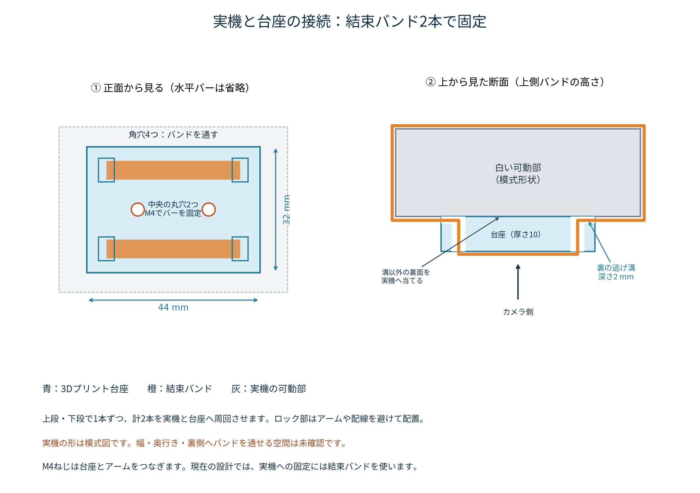
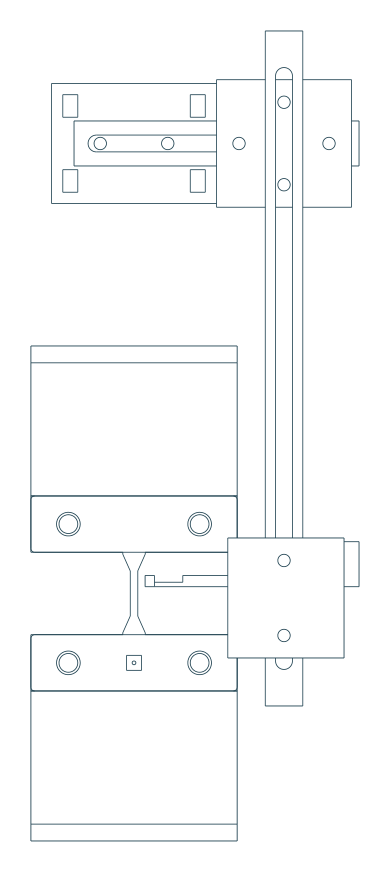

# 同期用目印：可動側ホルダのみ製作・下側つかみ治具を固定基準に使用

**今の動画の画角なら、下側のつかみ治具に目印を付けて固定基準として使えます。別の固定側ホルダは製作しません。** 今回のモデルは、ロードセル上流の可動部へ付けるホルダだけです。ねじはM4のみで、ナット・金属インサート・座金は使いません。機械へは結束バンドで固定する案です。

**プリント後にM4×0.7タップ加工が必要です。** STEP/STLは径3.3 mmの下穴モデルで、ねじ山は造形していません。普通のM4ねじをそのまま無理にねじ込む方式ではありません。

- [可動側ホルダの組立STEP](STEP/assembly_moving.step)
- [M4ねじを含む参考STEP](STEP/assembly_with_M4_screws_REFERENCE.step)
- [既存つかみ治具・固定目印を含む参考配置STEP](STEP/assembly_with_supplied_grips_REFERENCE.step)
- [組立・タップ加工ガイドPDF](assembly_guide.pdf)
- [部品別STEP](STEP/) / [印刷用STL](STL/)

組立STEPを一体で印刷せず、部品別STLを使ってください。GitHubのファイル画面の「Download raw file」からダウンロードできます。旧M3版や、固定側ホルダも製作する構成とは部品・ねじ数量が異なります。

## 実機と台座をどう接続するか

**実機と台座は結束バンド2本で固定し、M4ねじは台座とアームをつなぐために使います。** 機械本体のねじ穴へ直接M4で固定する取付部ではありません。

1. 01台座の、バンド逃げ溝がある裏面を、ロードセルより上流の白い可動部へ当てます。溝以外の面で平らに接触させます。
2. 上段の左右の角穴へ1本を通し、台座裏の溝から実機の裏側まで回して輪にします。
3. 下段も同様にもう1本を通します。上下2本で、上下方向の滑りと回転を抑えます。ロック部とバンド端はアーム・配線・可動機構を避けて置きます。
4. 台座中央の丸穴2つをM4タップ加工し、水平バーをM4×12で取り付けます。

台座には四隅の角穴4×6 mmと、その裏から側面へ抜ける幅6.4×深さ2 mmの溝があります。溝は、バンドを挟んで台座が浮くことを避けるためのものです。幅4.8×厚み1.5 mmのバンド包絡形状が、台座と他のホルダ部品・M4ねじに干渉しないことをCADで確認しました。

[取付け図PDF](mounting_detail.pdf) / [バンド経路の確認結果](mounting_validation.json)

**実機の幅・厚み・裏側へバンドを回す空間は未確認です。** 実機に平らな接触面があり、可動部だけを一周して縛れることが必要です。写真だけから、どの場所でもこの方式で付くとは判断していません。

接触面の溝を追加して01台座を更新しました。すでに出力した部品がある場合、形状変更は01のみです。他の5部品の形状・必要なM4ねじの本数は変えていません。

## 下側つかみ治具の使い方

下側の押さえ板の、ボルトの間にある平坦な面へ、白いラベルと黒点を付けます。例えば白地4×4 mm、黒点径約1 mmが出発点です。ボルト頭や段差にまたがらず、試料・つかみ口を隠さない位置にします。参考CADでは下側押さえ板の中央に、印刷部品ではないラベルと黒点を表示しています。

固定点は、画面の揺れや、固定側の位置変動を監視するための基準です。**固定点だけを付けても、CSVとの時刻合わせはできません。** 時刻合わせには、可動ホルダの点が動く量と、CSVのクロスヘッド移動量を照合します。

下側治具の前面と試料表面は奥行きが異なる場合があります。固定点の画素変動を単純に差し引けば、厳密な補正になるとは限りません。まずスマホを固定し、固定点は変動の確認に使います。補正を行う場合は奥行き差・倍率変化も確認します。下側治具自身が荷重でたわんだり滑ったりする影響も含むので、固定点が完全に不動とは仮定しません。

## 必要な金属ねじと道具

- **M4×12 mm：8本**
- **M4×16 mm：2本**
- 座金なしで長穴を押さえるため、**頭径9〜10 mm程度のトラス頭またはフランジ付きM4ねじ**を推奨。CADでは頭径10×高さ5 mmの包絡形状で干渉を確認しています。
- **M4×0.7タップとタップハンドル**。必要に応じ径3.3 mmドリルで下穴を仕上げます。
- 結束バンド2本。幅3.5〜4.8 mm程度・厚み1.5 mm以下を想定し、長さは実物の周長に合わせます。
- 可動点と固定点の白地・黒点。

M4×0.7のメートルねじ用です。径4 mmのタッピンねじとは別の規格です。皿ねじ用の座面はありません。

## 印刷する部品

| 部品 | 数 |
|---|---:|
| 01_strap_mount | 1 |
| 02_horizontal_bar | 1 |
| 03_corner_carriage | 1 |
| 04_vertical_rail_180 | 1 |
| 06_depth_carriage_R | 1 |
| 07_target_arm_R | 1 |
| 08_M4_fit_and_tap_coupon | 最初に1 |

ホルダは樹脂6部品です。04bの240 mmレールは交換候補なので、最初から印刷する必要はありません。固定側の台座・レール・アームは不要です。

可動ホルダの樹脂実体積は約46 cm³、密度1.24 g/cm³の100%充填換算で約57 gです。ねじ類は含みません。実際の質量はスライサー条件と印刷後の測定で確認します。

## 印刷・タップ加工

1. 最初に08の試験片を印刷します。下段の丸穴は左から径4.3／4.5／4.7 mmで、M4ねじが通るか確認します。上段は径3.2／3.3／3.4 mmで、M4タップ加工後にねじが入るか確認します。既定は逃げ穴4.5、下穴3.3です。
2. PLA、ノズル0.4 mm、積層0.2 mm、外周5本以上、充填40〜60%を出発点として試作します。ねじ受け付近は局所的に高密度にしてください。強度を保証する条件ではありません。
3. タップ対象は、01の2穴、03の4穴、06の2穴、07の2穴の**合計10穴**です。下穴を確認し、必要なら径3.3 mmに仕上げ、部品を保持してM4×0.7タップを穴軸に沿って通します。切粉を除去し、組立前にねじが入ることを確認します。長穴・逃げ穴にはタップを立てません。
4. STLは推奨印刷方向で配置済みです。先端受けは取付面を下にして奥行きレールが立つ向きです。ブリムと、スライサーで必要と判断したサポートを使います。目印アームの細い首は厚さ1.2×幅2 mmなので、取り扱いで曲げないようにします。

## 組立：ねじを入れる方向

「表」はカメラ側、「裏」は機械側です。各接続は2本で固定します。

| 接続 | ねじを入れる側 → タップ加工する受け側 | ねじ | 設計上のねじ込み長さ |
|---|---|---|---:|
| A | 水平バーの表 → 台座 | M4×12 | 8 mm |
| B | 水平バーの裏 → コーナー | M4×12 | 8 mm |
| C | 縦レールの表 → コーナー | M4×12 | 8 mm |
| D | 縦レールの裏 → 先端受け | M4×12 | 8 mm |
| E | 奥行きレールの下 → 目印アームの厚い足部 | M4×16 | 10 mm |

受け側は10／12 mm厚で、ねじ先端は受け側裏面の2 mm手前に収まる設計です。下穴自体は貫通し、タップを通せます。実物のねじ長さ・印刷寸法でも確認してください。BとDは裏からねじを入れるため、装置の外で組み立てます。

樹脂をつぶすほど締めず、滑り・緩みがないことを確認します。調整時はねじを少し緩めてスライドさせ、抜き差しを減らします。摩耗・割れ・空回りが出た部品は交換してください。

## 実機への取付け

**白い可動部の寸法とバンド経路は未確認です。** まず44×32×厚さ10 mmの台座を固定できるか確認してください。台座はロードセルより上流の白い可動部へ、バンド2本で固定します。ロードセル本体、配線、試料、固定側を一緒に縛らないでください。

参考配置では標線中央から台座まで上120 mmを仮置きしています。目印は試料中心の右4.2 mm・上3.3 mmに置く想定で、目印の前面を試料表面とほぼ同じ奥行きへ調整します。下側の固定点は既存の押さえ板へ貼り、標線2本・可動点・固定点が今の合焦距離で同じ画面へ入ることを確認します。

試料を付ける前に、小さい移動範囲で、バンド・樹脂ねじ・アームの滑り、振動、ねじ先端と装置の接触を確認します。録画中に機械移動量ゼロと可動点の基準位置を対応させ、可動点と同じ奥行きで画素寸法を校正し、動画とCSVの移動量を照合します。一定速度だけで位置オフセットと時刻差を両方自由に合わせないでください。

## CADで確認した範囲

- 部品8種類（標準6部品・交換レール・確認用試験片）のB-rep、STEP再読み込み、閉じたSTLメッシュ。
- 可動ホルダの樹脂部品間、添付つかみ治具との初期配置で体積干渉なし。公称試料との最小距離は約1.95 mm。
- M4ねじ10本の頭径10×高さ5 mm包絡形状、ねじ軸、受け位置、8／10 mmのねじ込み長さ。ねじ山はモデル化していません。
- 可動側を上へ0／2／5／10／20 mm移動した各位置で、ねじを含む可動側と下側つかみ治具との体積干渉なし。

試験機本体・白い可動部を復元したCADではありません。実機取付け、全干渉、樹脂ねじの強度・摩耗・緩み、支持体の剛性、同期精度は未検証です。説明図は縮尺不同で、ラベルは貼付例です。

[形状検証](validation.json) / [参考配置・メッシュ検証](context_validation.json) / [M4締結の検証](hardware_validation.json)

## 再生成

CadQuery 2.7で`python source/build_sync_jig.py`を実行します。参考配置とM4ねじを再検証する場合は、それぞれ`source/validate_context.py`、`source/validate_M4_joints.py`へ`--mount "取り付け治具.step" --cover "固定治具.step"`を指定します。ガイドは`python source/build_guide.py`で再生成します。ガイド生成にはNoto Sans CJKフォントが必要です。`parameters.json`は設計値の記録用です。
