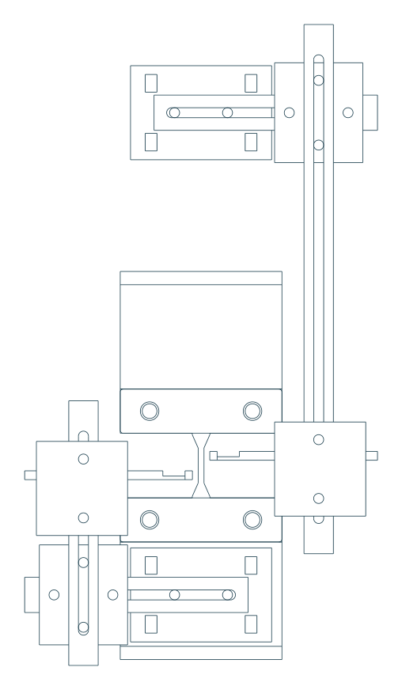
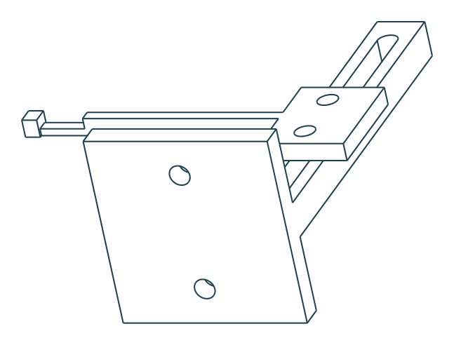

# 引張試験：撮影・同期用目印ホルダ（調整式・試作版）

MCT-2150Wで、クロスヘッドの移動をスマートフォン動画へ写すための治具です。可動側と固定側を別々に支持し、試料の横へ目印を出します。単位はmmです。説明図は縮尺不同で、PDFを印刷したものは寸法ゲージとして使用しないでください。

**試験機側の白い可動部の寸法・バンドを回す経路は未確認です。このモデルは、実機への取付けを保証する完成寸法の治具ではなく、調整式の試作モデルです。まず48×32 mmの台座を取り付けられるか、下記の取付条件を確認してください。**

- [可動側＋固定側の組立STEP](STEP/assembly_both.step)
- [可動側だけの組立STEP](STEP/assembly_moving.step)
- [固定側だけの組立STEP](STEP/assembly_fixed.step)
- [添付されたつかみ治具を含む参考配置STEP](STEP/assembly_with_supplied_grips_REFERENCE.step)
- [組立・取付ガイドPDF](assembly_guide.pdf)
- [部品ごとのSTEP](STEP/) / [3Dプリント用STL](STL/)

GitHubのファイル画面で「Download raw file」を選ぶとダウンロードできます。組立STEPには、ねじ・ナット・結束バンドは含めていません。**組立状態を丸ごと印刷せず、部品別STLを使ってください。**

## 構成と取付位置

上の台座は、**ロードセルより上流の白い可動部**へ結束バンド2本で固定する案です。ロードセル本体、試料をつかむ上側治具、配線には固定しません。

下の台座は、下側「取り付け治具」の押さえ板より下にある縦壁へ、別の結束バンド2本で固定する案です。添付STEP上では、この縦壁の正面は幅55×高さ35.5 mmです。台座の接触面は48×32 mmで、その範囲内へ置ける配置を作りました。ただし、裏側へバンドを回せることは現物で確認が必要です。押さえ板の高さ15 mmの面へ、この32 mm高の台座を取り付ける案ではありません。

可動側と固定側の台座は、互いにつながりません。アーム・ねじ先端・バンド端が、試料、ロードセル、反対側の支持体へ接触しないようにします。

参考配置は、35 mm長の試料の両端を各6.5 mmつかみ、つかみ口間隔を22 mmとしたものです。試験機本体、ロードセル、白い可動部の形状を復元した組立CADではありません。参考試料の肩形状は模式的です。

## 取付前に確認する寸法

| 項目 | 本モデルの条件 |
|---|---|
| 台座 | 幅48×高さ32 mm、樹脂板厚7 mm、後ろの逃げ3 mm |
| 接触する場所 | 台座の左右端にある幅4 mmのリブが安定して接触する平面 |
| バンド | 各台座に2本。幅3.5〜4.8 mm程度。長さは実物の周長に合わせる |
| 可動側取付高さ | 標線間中央より上120 mmを仮置き。長穴で調整。届かなければ長いレールまたは寸法変更が必要 |
| 固定側取付高さ | 標線間中央より下44 mmを、添付つかみ治具に合わせて仮置き |
| 外側の縦レール | 参考配置では試料中心から左右40 mm。機械柱などとの空間は現物で確認 |
| 奥行き調整 | 目印の前面を、台座接触面から手前18.5 mm〜奥23.5 mmの範囲で調整可能（形状上の範囲） |

長穴の端まで使えば、どの取付位置でも周辺部品と干渉しないという意味ではありません。まず結束バンドの経路と取付面を確認し、次に台座だけを試し、その後に全体を組み立ててください。

## 印刷する部品

| 番号・ファイル名 | 数 | 役割 |
|---|---:|---|
| 01_strap_mount | 2 | 結束バンド用台座、M3ナット収納部付き |
| 02_horizontal_bar | 2 | 台座から外側へ出す長穴バー。固定側は反転して使用 |
| 03_corner_carriage | 2 | 水平バーと縦レールの接続 |
| 04_vertical_rail_180 | 1 | 可動側の縦レール（全長180） |
| 05_vertical_rail_90 | 1 | 固定側の縦レール（全長90） |
| 06_depth_carriage_R / L | 各1 | 高さ・奥行きを調整する先端受け |
| 07_target_arm_R / L | 各1 | 試料の横へ目印を出すアーム |
| 08_fastener_fit_coupon | 最初に1 | 穴・ナット収納部の印刷誤差を確認 |

既定構成は樹脂部品12個です。04bの240 mmレール、05bの120 mmレールは交換候補で、最初から両方印刷する必要はありません。レールを交換した場合は、取付位置を変更し、再度干渉を確認してください。

可動側の樹脂実体積は約29 cm³、固定側は約27 cm³です。密度1.24 g/cm³の100%充填換算で約36 g／33 gです。ねじ類の質量は含みません。実際の質量はスライサー条件と印刷後の測定で確認します。

## ねじ類と目印

- M3×12 mmねじ：4本（台座と水平バーの接続）
- M3×16 mmねじ：16本（その他の接続）
- M3六角ナット：20個。台座の収納部は一般的な二面幅5.5 mm・厚さ2.4 mmのナットを想定。背の高いナイロンナットは入りません。
- M3平座金：40枚程度。台座側は厚さ約0.5 mmの平座金を想定。
- 結束バンド：4本。締付け後の余りは動作範囲に出さない。
- 目印：先端の2.5×3 mmの面へ白いラベルまたは白色塗装を施し、中央に直径0.6〜1 mm程度の黒い点を付ける。印刷の積層模様だけを追跡点にしない。

台座以外は、ねじ頭とナット側に平座金を入れます。樹脂をつぶすほど締めず、調整後に滑り・回転がないか確認します。台座側のナット収納部には裏側の平座金を入れません。ねじ長さは実際のナット・座金の厚さでも確認し、突き出したねじ先端が機械に触れないことを確認してください。

## 組立順

1. 08の試験片で、穴とナットの入り方を確認します。丸穴は左から径3.2／3.4／3.6、六角収納部は左から二面幅5.7／5.9／6.1です。既定設計は穴径3.4、ナット収納部の二面幅5.9です。
2. 台座裏からM3ナットを2個入れます。表側から水平バーをM3×12で仮止めします。
3. 水平バーへコーナーを2本のM3×16で取り付けます。コーナーのもう一組の穴へ縦レールを取り付けます。水平側ねじを先に付けると作業しやすくなります。
4. 縦レールへ06の先端受けを2本のねじで取り付けます。Rが可動側、Lが固定側です。
5. 先端受けの奥行き方向の長穴へ07のアームを載せ、2本のねじで仮止めします。
6. 各台座を別々の取付部へ結束バンド2本で固定します。ロードセルより上流／下側固定部を取り違えないでください。
7. 高さと奥行きを調整し、目印の前面を試料表面とほぼ同じ奥行きへ合わせます。締付け後に、ねじ・長穴部が動かないことを確認します。

参考配置の目印中心は、試料中心から右4.2 mm・上3.3 mmが可動側、左4.2 mm・下3.3 mmが固定側です。目印を含む横幅は約10.9 mmです。今の合焦距離を基本に、標線2本と目印2つが同じ画面へ入ることを確認します。撮影範囲を狭くした場合は、この横幅が入るか再確認してください。

## 3Dプリント条件の出発点

PLAを用いた試作を想定します。ノズル0.4 mm、積層0.2 mm、外周4本以上、充填30〜50%を出発点に、剛性と穴寸法を確認してください。条件が成立することを保証した値ではありません。

STLは推奨印刷方向で原点へ配置済みです。バー類は平らに寝かせ、先端受けは大きな取付面を下にして奥行きレールが立つ向きです。先端受けにはブリムを推奨します。スライサーで接地・細い先端・穴のブリッジを確認し、サポートの要否を決めてください。240 mmレールは標準180 mmレールより大きな配置スペースが必要です。

先端の首は厚さ1.2×幅2 mmの小さい部分です。取り扱い時に先端を押したり、サポートを強引に引き剥がしたりしないでください。

## 最初の動作・同期確認

試料を付ける前に、小さな移動範囲から動作確認します。支持体やねじ先端がロードセル・つかみ具・配線・反対側の治具へ触れず、バンドと長穴部が滑らないことを確認します。実機のリミットと非常停止へのアクセスを保ちます。

録画中に移動量ゼロと可動目印の基準位置を対応させ、同じ奥行きのスケールで画素寸法を校正します。その後、動画の可動目印の移動とCSVのクロスヘッド移動を比較し、時間差と残差を確認します。一定速度だけで位置オフセットと時刻差を両方自由に合わせず、ゼロ位置と縮尺は別に決めます。停止中のCSV記録が連続するとは仮定しません。

固定目印の変動には、カメラの動きだけでなく固定治具自身の変形・滑りも入り得ます。静止時の安定性、移動時の振動、往復後の位置の再現性を確認してください。この治具だけで同期精度や荷重精度が保証されるわけではありません。

## CADで確認した範囲

- 部品12種類の形状が有効で、各部品は1ソリッド。STEP書き出し・再読み込み後も有効で、体積が一致。
- 既定の可動・固定組立は樹脂12部品で、相互の体積干渉なし。
- 添付されたつかみ治具と公称試料を使った初期位置の干渉確認60組で、体積干渉なし。先端と公称試料の最小距離は約1.95 mm。
- 可動側を上へ0／2／5／10／20 mm動かした各位置で、固定側との体積干渉なし。
- 部品別STL12種類は閉じたメッシュで、非多様体エッジなし。

上記は指定したCAD配置での確認です。試験機本体・ロードセル・ねじ・バンド・実際の変形試料を含む全干渉、実物の剛性、振動、印刷後の寸法、同期精度は未検証です。JIS K 6251がこの同期治具を規定しているわけではありません。

[形状検証結果](validation.json) / [参考配置・メッシュ検証結果](context_validation.json) / [配置・設計値](parameters.json)

## CADを再生成する場合

`source/build_sync_jig.py`をCadQuery 2.7で実行します。配置の高さ・奥行き・レール長などはスクリプト先頭の`P`を、外形や長穴などの部材形状は各関数の数値を変更して再生成できます。`parameters.json`は記録用で、スクリプトから自動で読み込む設定ファイルではありません。寸法変更後は干渉・メッシュ・取付条件を再検証してください。

再検証・図の再生成には、`python source/validate_context.py --mount "取り付け治具.step" --cover "固定治具.step"`、`python source/build_guide.py`を使います。ガイド生成にはNoto Sans CJKフォントが必要です。
