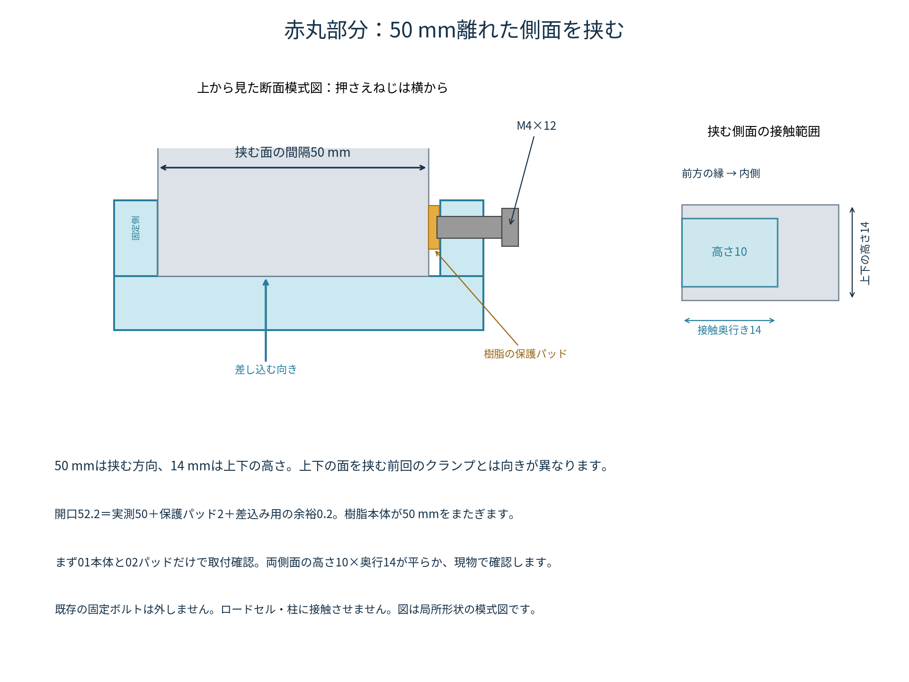

# 赤丸部分を50 mmの方向に挟む同期目印ホルダ

ねじ穴・はめあい寸法の更新：**タップ用下穴φ3.242 mm／通り穴・長穴幅4.2 mm／クランプの合計隙間0.2 mm**。受け側は印刷後にM4×0.7のタップ加工をします。

取付方向の確認に合わせ、赤丸の前方突出部の**50 mm離れた両側面**を挟む形へ修正しました。上下の高さ14 mmを挟む旧T14版、黄色部分を使う案は採用していません。

- [印刷後の組立手順書（図付きPDF・12ページ）](assembly-manual/assembly_manual_R_S50.pdf) / [ブラウザで読む](assembly-manual/README.md)
- [取付方向・接触範囲の図（PDF）](mounting_direction.pdf)
- [設計時の簡易ガイド（PDF、4ページ）](assembly_guide.pdf)
- [R側の組立STEP](STEP/assembly_R.step) / [L側の組立STEP](STEP/assembly_L.step)
- [50 mmの局所形状に取り付けたクランプ参考STEP](STEP/clamp_R_S50_REFERENCE.step)
- [STEP・STL・図面一式ZIP](tensile_sync_side_clamp_S50_M4x12.zip)

GitHubのファイル画面で「Download raw file」を選ぶと保存できます。組立STEPは形状確認用です。印刷にはRまたはLの部品別STLを使います。

## 方向と寸法

| 項目 | 設計に使った意味 |
|---|---|
| 50 mm | ユーザーが確認した、赤丸の挟める両側面の間隔 |
| 14 mm | 赤丸部分の上下の高さ。ここを上下から挟む構成ではない |
| 開口52.2 mm | 50＋保護パッド厚さ2＋合計の差込み余裕0.2 |
| ジョーの接触高さ10 mm | 高さ14の中央へ配置。上下に各2 mm余る局所配置 |
| ジョーの差込み深さ14 mm | 設計値。両側面で確保できるか現物で確認 |
| 本体外形 | 68.2×24×10 mm（ねじを含めない） |
| 押さえねじP | 側面から横向きにM4×12を1本。金属とねじの間にパッドを入れる |

座標Xは確認された50 mmの方向、Zは上下の14 mmの方向です。「写真の奥行き」という呼び方で寸法が混同されないよう、図では50と14を分けて示しました。

前に伺った空き奥行き20 mmを局所形状の説明に使っていますが、**側面の接触範囲が平らであることを確認した値ではありません**。最初にクランプだけを試作し、両側に高さ10×奥行14の接触範囲があることを確認してください。丸み、段差、既存部品によって平らに当たらない場合は、そのまま強く締めません。

既存のロードセル固定ボルトは外しません。上面と下面に爪を回す構成ではなく、両側面を押さえます。クランプが可動ブラケットにだけ接触し、ロードセル、柱、配線などに触れない位置を選びます。

## 最初に印刷するもの

1. `01_side_clamp_S50`（取付本体）
2. `02_protective_pad`（保護パッド）
3. `COMMON/09_tap_test_coupon`（下穴・通り穴の確認用）

まず上の3点で取付け・穴加工を確認します。実機で安定して取り付くことを確認してから、アームを印刷します。クランプ本体のU字が水平になるSTL配置です。パッドは厚さ2 mmの方向が積層方向です。

PLA、ノズル0.4、積層0.2、外周5本以上、充填40〜60%を試作条件の出発点とし、クランプ・ねじ受けは局所的に高密度にします。保持力・強度を保証する印刷条件ではありません。スライサーでブリッジと必要なサポートを確認してください。

## 部品とねじ

Rはアームがカメラ側から見て右に出る形、Lは左右反転です。実機の空きがある側を選び、R/Lの一式を混在させず使用します。

| 印刷部品 | 数 |
|---|---:|
| 01_side_clamp_S50 | 1 |
| 02_protective_pad | 1 |
| 03_horizontal_bar | 1 |
| 04_corner | 1 |
| 05_vertical_rail_190 | 1 |
| 06_ribbed_depth_carriage | 1 |
| 07_cross_slide_carriage | 1 |
| 08_sliding_target_flag | 1 |

樹脂8部品と**M4×12を13本**で構成します。ナット・インサート・座金は使用しません。05bの240 mmレールは交換候補で、標準構成では印刷不要です。

クランプの幅が増えたため、水平バーを延長し、コーナーと縦レールの位置を18 mm外側へ変更しています。最新の組立STEPと同じ版で組んでください。

写真のすりわり付き小ねじのような、平らな座面を想定しています。頭径7 mm以上を使用条件とし、頭径10×高さ5 mmの包絡形状で干渉確認しています。実際の頭径は未測定です。皿ねじ用の座面ではありません。

## タップ加工と締結

M4並目（ピッチ0.7）の、**めねじ内径の基本寸法**は `D1 = 4 − 1.082532 × 0.7 ≈ 3.242 mm`です。今回はこの値に合わせ、タップ用下穴をφ3.242 mmに指定しています。ねじ山は印刷後にM4×0.7タップで加工します。

ねじを通す穴・長穴の幅は、M4の外径4.0＋直径方向の余裕0.2＝4.2 mmです。これは片側0.1 mmずつの隙間に相当します。クランプ開口にも合計0.2 mmの余裕を設けています。印刷後の寸法精度を保証する値ではありません。パッドのくぼみと07奥の加工逃げもφ4.2へ変更しました。

**印刷後にM4×0.7のタップ加工が必要です。** ねじ山は直接造形せず、ご指定のめねじ内径に合わせ、下穴径3.242 mmを設けています。必要に応じ下穴を仕上げてから、01の3穴、04の4穴、06の2穴、07の4穴の計13穴を加工します。装置へ取り付ける前に加工・切粉除去を行います。

COMMONの試験片は、下段が径4.0／4.2／4.4の通り穴、上段が径3.2／3.242／3.3のタップ用下穴。既定は通り穴4.2、下穴3.242です。普通の小ねじを無理に直接ねじ込む方式ではありません。

「表」はカメラ側、「裏」は機械側です。

| 接続 | ねじを入れる側 → ねじ受け側 | 本数 |
|---|---|---:|
| A | 水平バーの表 → 01本体 | 2 |
| B | 水平バーの裏 → 04コーナー | 2 |
| C | 縦レールの表 → 04コーナー | 2 |
| D | 縦レールの裏 → 06奥行き調整部 | 2 |
| E | 奥行きレールの下 → 07横スライド受け | 2 |
| F | 目印バーの表 → 07横スライド受け | 2 |
| P | 01の側面から横へ → パッドを押す | 1 |

全13本でM4×12、設計上のねじ係合長さ8 mmです。07の奥の径4.2は逃げ穴で、そちらへタップを立てたり、そちらからねじを入れたりしません。B・Dは機械側からねじを入れるため、実機取付け前に机上で仮組みします。

Pは押さえねじです。参考CADでは、先端がパッドの浅いくぼみに接触した状態で、頭が本体から3.4 mm浮いています。**頭を本体へ着座させるまで締め込まないでください。** 滑らない範囲で軽く保持し、樹脂の割れ・空回りがないか確認します。締付トルクは未設定です。

## 位置合わせと撮影

クランプ単体の取付けを確認し、いったん外してアームを仮組みしてから実機へ取り付けます。縦長穴で高さ、奥行きレールで奥行き、横長穴で目印の横位置を合わせます。

Rの横調整範囲は、クランプ中央から目印先端まで−30〜＋46 mmです。Lは左右反転です。奥行きの目印前面はクランプ前縁基準で手前18〜奥30 mmの設計範囲です。これらは部品同士の調整範囲で、全範囲を実機で使用できることは保証していません。

目印先端2.5×3 mmに白地と黒点を付け、試料とほぼ同じ奥行きへ配置します。固定点は既存の下側つかみ治具へ白地と黒点を付けて作り、別の固定側ホルダは製作しません。

試料を付けずに小さい範囲で動かし、滑り、振動、往復後の再現性、周辺との接触を確認します。今の合焦距離で標線2本・可動点・固定点が入るように撮影します。機械移動量ゼロと目印の基準位置を対応させ、同じ奥行きで縮尺を校正し、動画とCSVの移動量を照合します。固定点だけでは時刻同期はできません。

## 検証範囲

部品19ファイルの有効形状・STEP再読み込み・閉じたSTL、R/L各13本のねじ頭と軸の干渉・8 mmの係合を確認しています。局所形状と樹脂部品の干渉、および提供されたつかみ治具との仮配置で0／2／5／10／20 mmの移動を確認しています。調整端9通りでの検証は[adjustment_validation.json](adjustment_validation.json)に記録しています。

**クランプ高さ120 mmは説明用の仮置きで、実測値ではありません。** 機械本体、ロードセル、既存ボルトの全形状はモデル化していません。実機適合、保持力、樹脂ねじの強度、剛性、耐久性、同期精度は未検証の試作設計です。局所モデルで干渉がないことは、実機全体の取付確認を代替しません。

[形状・締結検証](validation.json) / [設計値](parameters.json) / [組立図の検証](guide_validation.json)

再生成：CadQuery 2.7環境で `python source/build_side_clamp.py --mount "取り付け治具.step" --cover "固定治具.step"`。図とガイドは `python source/build_guide.py`。Noto Sans CJKフォントを使用します。
