# S50・R用 同期目印ホルダ 組立手順書

[図付きPDFを開く](assembly_manual_R_S50.pdf)

対象：50 mmの両側面を挟むS50版。下穴φ3.242、通り穴・長穴4.2。樹脂8部品とM4×12ねじ13本。

Rは試験機を正面から見て縦アームが右へ出る構成。表＝カメラ側、裏＝機械側。作業順は **タップ → クランプ単体確認 → A → B → C → E → F → D → 実機へPで固定 → D/E/Fで調整**。

## 部品

- 01 クランプ本体：1個。U字形。ねじで金属の
50 mmの両側面を挟む。
- 02 保護パッド：1個。小さな薄板。片面に
ねじ先用のくぼみ。
- 03 水平長穴バー：1個。長さ94 mm、幅12 mm。
横向きの長穴バー。
- 04 コーナー：1個。十字に並ぶ4穴。
厚さ10 mmのブロック。
- 05 縦レール190：1個。長さ190 mm、幅10 mm。
最も長い長穴部品。
- 06 奥行き調整部：1個。ブロックとリブ付き
レールが一体。
- 07 横スライド受け：1個。横2穴・底2穴。
小径側がタップ入口。
- 08 目印バー：1個。長穴バーの片端に
細い目印先端がある。

## 受け側の加工

01は正面2穴と側面1穴、04は十字の4穴、06はブロック側上下2穴、07は横2穴と底2穴をM4×0.7でタップ加工します。07は小径側から加工し、大径の加工逃げ側へはタップを立てません。バリ・切粉を除去してください。

## クランプ単体の取付け確認

Pを緩め、先端が内側へ突き出さない位置にします。赤丸で確認した前方部分の50 mm離れた両側面へ01を差し込みます。02はくぼみをねじ側、平らな面を金属側へ向けます。Pを少しずつ回して保持し、頭を本体へ着座させるまで締めません。確認後は実機から外して机上で組み立てます。01と02だけ印刷した場合は、ここまでで構いません。

## 3　03を01へ取り付ける（A）

M4×12を2本。ねじはカメラ側（表）から。

表側から見た図

1. 01の正面にある横並び2穴へ、03の長穴を重ねる。
2. 03は右へ長く伸ばし、01が03の左端寄りになる位置に置く。
3. 03側からM4×12を2本通し、01のタップ穴へ入れる。
4. 2本とも手で数山掛けてから、交互に軽く締める。03の長穴はタップ加工しない。

確認：ねじ頭 → 03（厚さ4 mm）→ 01の順。03が本体に平らに当たる。

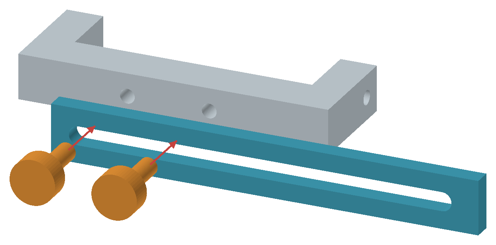

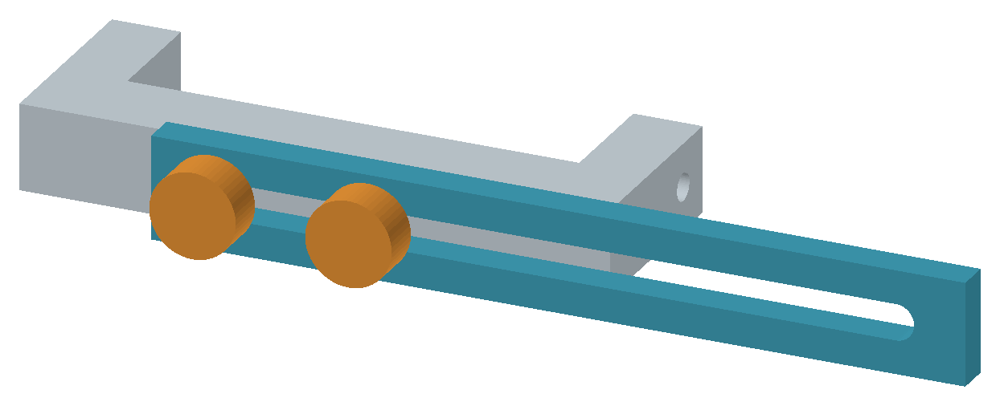

## 4　04を03の先端へ取り付ける（B）

M4×12を2本。ねじは機械側（裏）から。

裏側から見た図：正面から見た左右とは反転します

1. 03の反対側の端に04を置く。04の横並び2穴を、03の長穴へ合わせる。
2. 04は03のカメラ側に位置する。ねじは03の裏側から入れる。
3. M4×12を2本通し、04の横並び2穴へ手で数山入れる。
4. 2本を交互に軽く締める。04の残る上下2穴は、次の05固定用に空けておく。

確認：ねじ頭 → 03 → 04の順。Bは裏から入れるので、実機取付け前に組む。

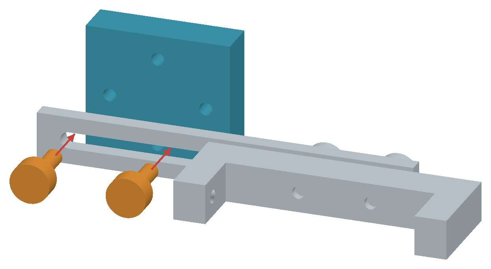

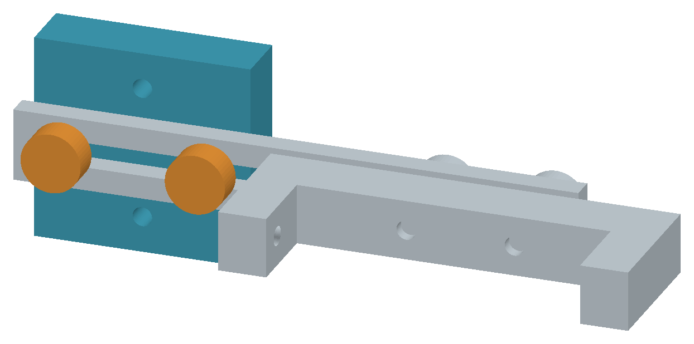

## 5　05を04へ取り付ける（C）

M4×12を2本。05の縦レールは下へ長く伸ばす。

表側から見た図。05は上端部分だけを表示

1. 05の上端寄りの長穴を、04の上下2穴へ重ねる。
2. 05が下向きに長く伸びる姿勢にする。
3. 05の表側からM4×12を2本通し、04の上下2穴へ入れる。
4. 縦レールを真っすぐにし、2本を交互に軽く締める。これで上部ユニットが完成。

確認：ねじ頭 → 05（厚さ4 mm）→ 04の順。A・B・Cで計6本。

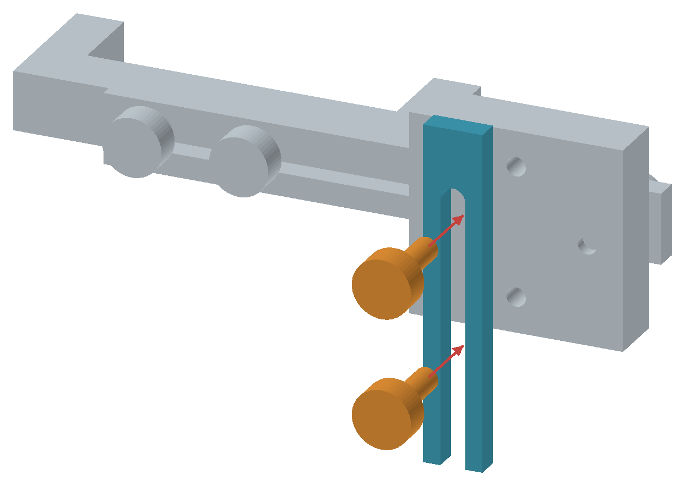

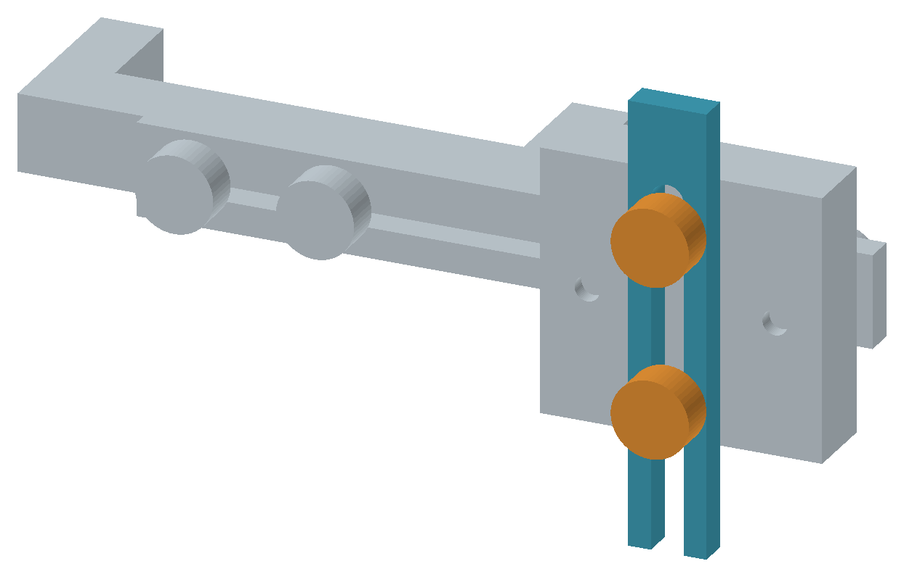

## 6　07を06へ取り付ける（E）

M4×12を2本。ねじはリブ付きレールの下から上へ。

下側から見た図。赤矢印はねじの進む向き

1. 06はレールのリブ・溝が下側を向く姿勢にする。
2. 07の底にある小径2穴を下へ向け、06の長穴の上に置く。
3. 06の溝側からM4×12を2本、上向きに通して07の底2穴へ入れる。
4. 奥行き調整のため、2本はがたつかない程度の仮締めにする。07の横並び小径2穴はカメラ側へ向ける。

確認：ねじ頭 → 06の中央板（厚さ4 mm）→ 07の底のタップ穴。リブは下側。

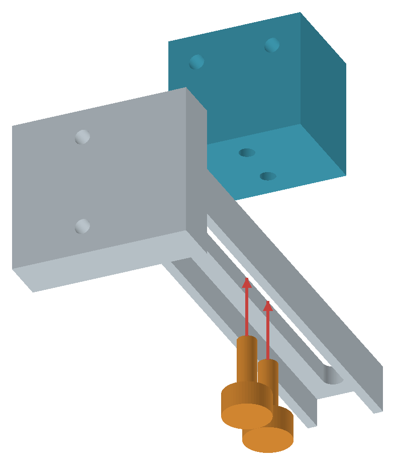

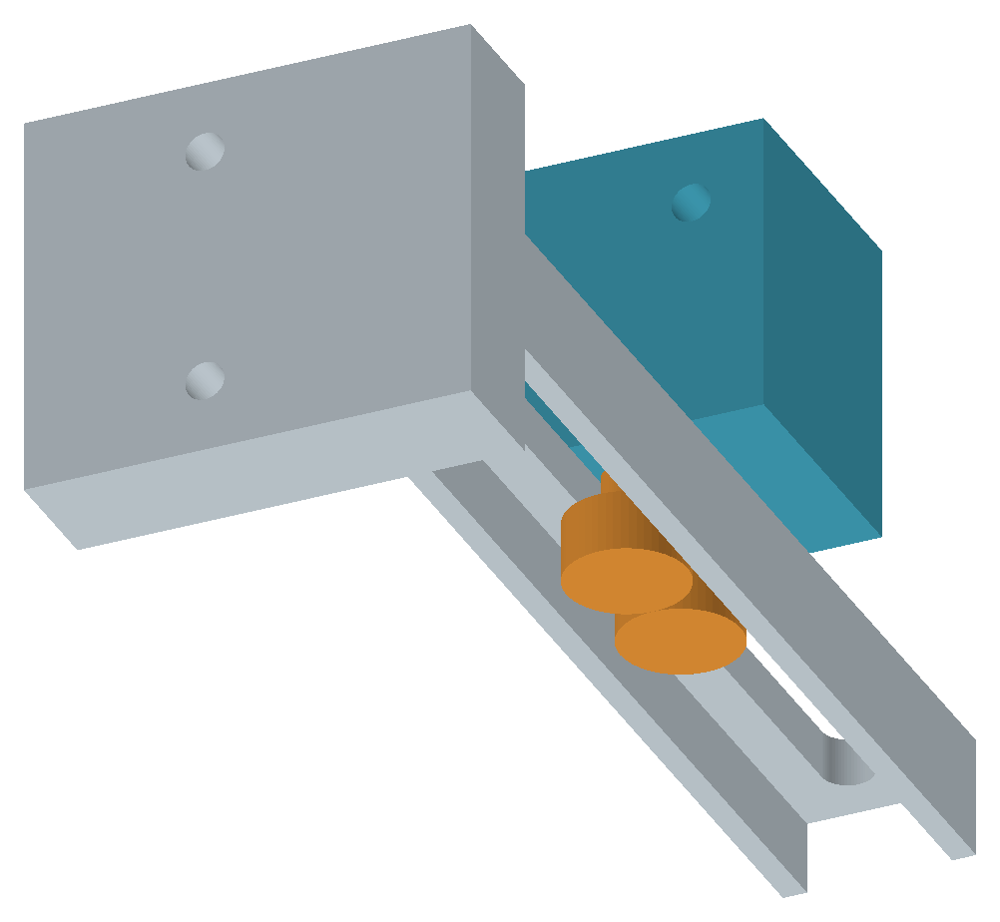

## 7　08を07へ取り付ける（F）

M4×12を2本。08の細い目印先端を試料側へ向ける。

表側から見た図。R用では目印先端は左へ出ます

1. 08の長穴を、07の横並び小径2穴へ重ねる。
2. R用では、08の細い目印先端が左、長穴が右になる姿勢にする。
3. 08の表側からM4×12を2本通し、07の横並び2穴へ入れる。
4. 横位置は後で合わせるので、2本を軽く仮締めする。これで下部ユニットが完成。

確認：ねじ頭 → 08（厚さ4 mm）→ 07の横のタップ穴。E・Fで計4本。

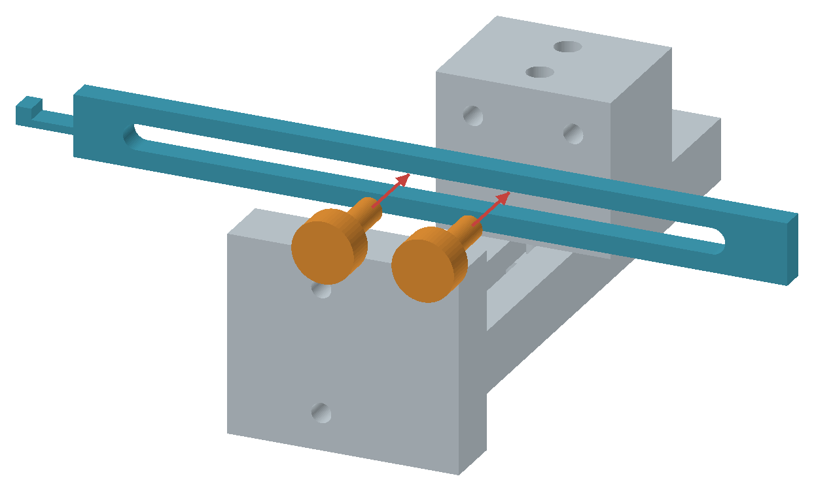

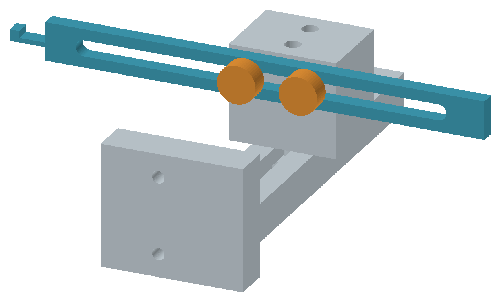

## 8　下部ユニットを05へ取り付ける（D）

M4×12を2本。ねじは05の裏側から06へ。

裏側から見た図。05は下端部分だけを表示

1. 下部ユニットの06ブロックを05へ当て、上下2穴を05の長穴へ合わせる。
2. 05の裏側からM4×12を2本通し、06の上下2穴へ入れる。
3. 下部ユニットを手で支え、いったん05の下部に置いて仮締めする。
4. 机上で全体を確認する。目印の高さは実機へ付けてからDで調整する。

確認：ねじ頭 → 05 → 06のブロック。A〜Fで計12本。残るPの1本は実機固定用。

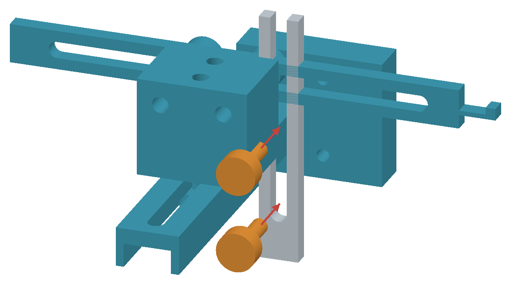

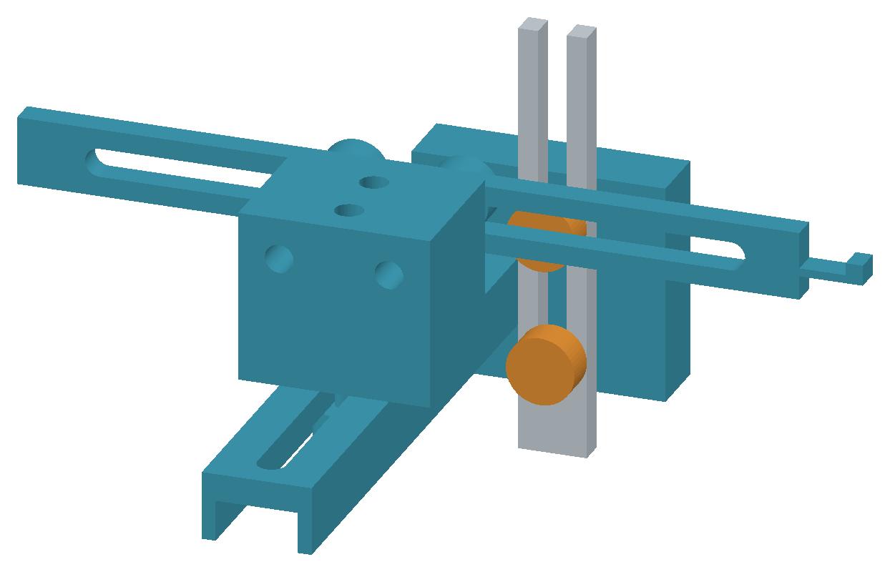

## 実機への取付け

A〜Fの12本を机上で組んでから、Pで赤丸の50 mmの両側面へ固定します。02のくぼみをねじ先へ向けます。既存のロードセル固定ボルトは外しません。Pの頭を面へ着座させるまで締め込まず、ずれない範囲で保持します。機械全体・ロードセル・配線・柱・ガイドとの接触を確認します。

## 位置調整

下部ユニットを手で支え、D（05裏の2本）で高さ、E（06下の2本）で奥行き、F（08表の2本）で横位置を合わせます。目印先端の白地と黒点を、試料表面とほぼ同じ奥行きへ置きます。固定点は既存の下側つかみ治具へ付けます。標線2本・可動点・固定点を、今の合焦距離で撮影できる位置に合わせます。

## 最終確認

A〜F各2本とP1本の計13本を確認。試料を付けず小さい範囲で往復させ、滑り・振動・接触と、目印が元の位置へ戻るかを確認します。CAD上の手順であり、実物の保持力・締付トルクは未実測です。

## 元のCADと再生成

[対応するCAD一式](../README.md)。本手順書の追加に伴うCAD形状の変更はありません。

`python source/render_steps.py --design-root ..` で図を生成し、`python source/build_manual.py` でPDFを生成します。CadQuery、NumPy、Pillow、PyMuPDF、fontToolsとNoto Sans CJKフォントを使用します。
