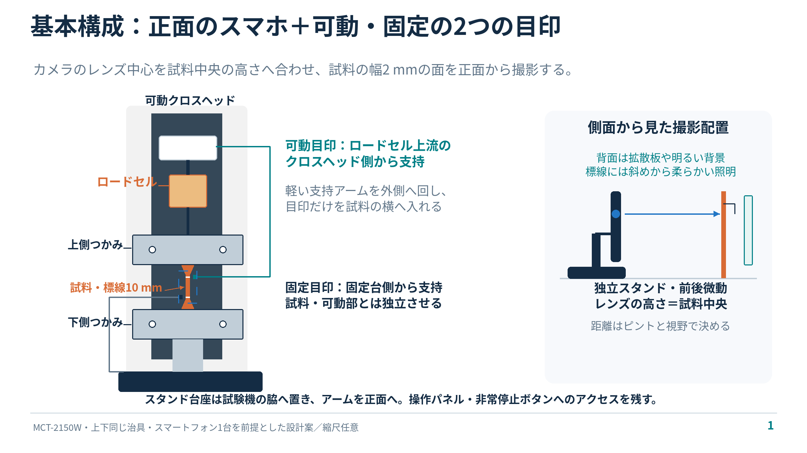

# MCT-2150W：スマホ1台の撮影・同期配置案

上下に「取り付け治具＋固定治具（押さえ板）」を1組ずつ使い、スマートフォン1台で縦・横ひずみを撮る構成です。提供された写真と2つのSTEPを確認して作成しました。

- [編集用PowerPoint（5枚）](tensile_camera_sync_layout_editable.pptx)：図形・線・テキストはPowerPoint内で編集できます。説明は各ページのノートにもあります。
- [閲覧用PDF（5ページ）](tensile_camera_sync_layout.pdf)
- [詳しい配置・同期・予備試験の説明](layout_notes.md)
- [STEPから読み取った形状寸法](fixture_geometry.json)
- [視野と画素数の計算例](optical_budget.csv)

GitHubでPowerPointがプレビューされない場合は、ファイル画面の「Download raw file」からダウンロードしてPowerPointで開いてください。

## 推奨する配置

1. 試験片の幅2 mmが見える面を、機械の正面側へ向ける。
2. スマホの使用レンズの中心を標線間の中央の高さに合わせ、光軸を試料面へ垂直にする。
3. 独立したスタンドの台座を機械の脇へ置き、アームでスマホを正面へ出す。操作パネルと非常停止を手で操作できる空間を残す。
4. 試料の横に、クロスヘッドと一緒に動く小さな目印と、固定台側の目印を置く。支持部は別々にし、試料へ触れないようにする。
5. 拡散した照明を固定し、輪郭と白い標線が同時に見える条件を探す。背面照明は柱との間に置ける場合の候補。スマホのピント・倍率・可能なら露出を固定する。

カメラから試料までの距離は、実機のレンズでピントが合い、必要な視野が得られる位置から決めます。スマホ機種名だけから最短撮影距離や4K動画の対応を仮定していません。画面上のデジタルズーム倍率だけでは計測分解能を判断できません。

## つかみ治具で確認できたこと

| 対象 | STEPから確認した値 |
|---|---|
| 固定治具＝押さえ板 | 55 × 15 × 4.42 mm、1ソリッド |
| 押さえ板の穴 | 貫通穴径6.3 mm、中心間35 mm |
| 取り付け治具 | 全体55 × 40 × 55 mm、2ソリッド |
| 上部ブロックの穴 | 径約5 mm、中心間35 mm。ねじ山・ねじ規格は未確認 |

公称全長35 mmの試料なら、端を各6〜7 mmずつ挿入し、中央約21〜23 mmを露出させる案です。図は各6.5 mm・露出22 mmの例です。実物の端部形状と長さに合わせて調整してください。標線間10 mmとつかみ口間隔22 mmは別の値です。

15 mmのつかみ面全体へ両端を入れると、中央には35−15−15＝5 mmしか残りません。端部だけを挟み、平行部や標線を隠さないようにします。試料を引き伸ばしてつかみ口の間隔へ合わせず、無負荷の試料に合わせて機械位置を調整します。左右の締付け、滑り、押さえ板の傾きは予備試験で確認します。試料の肩部は図では模式的な形で表しています。

## 同期用の治具は必要か

クロスヘッドの動きをそのまま撮影できれば、追加治具は必須ではありません。今回のように標線10 mmを拡大する場合、クロスヘッドが視野外になるため、軽い目印ホルダが役立ちます。

可動目印の支持点は、ロードセルより上流の可動クロスヘッド側を候補とします。支持アームをつかみ治具の外側へ回し、先端の小さな目印だけを試料の横へ出す構成です。固定目印は固定台側から支持します。目印面を試料表面とほぼ同じ奥行きにそろえます。可動側と固定側を連結せず、試料や治具への接触がないことを動作範囲全体で確認します。

実機の取付穴・アーム長・柱との空間は写真から確定できません。この資料は配置案で、製作寸法を確定した目印ホルダのSTEPではありません。

### 時刻合わせ

1. 録画を開始し、静止中に機械の移動量をゼロにする。その同じ機械位置で、動画の可動目印の基準位置を記録する。
2. 同じ奥行きのスケールで画素寸法を校正する。固定目印を基準に、可動目印の相対移動量をmmへ換算する。
3. CSVの機械移動量と動画の目印移動量が一致する時刻差を求める。比較するのは同じクロスヘッドの移動量で、試料の標線間の伸びを機械移動へ一致させる操作はしない。
4. 全区間の残差・追跡の繰返し性を確認する。動画には元のフレーム時刻を使い、スマホの可変フレームレートを考慮する。

一定速度だけでは「任意の位置オフセット」と「時刻差」を同時に自由に求められません。ゼロ位置・縮尺を独立に固定した上で時刻差を推定します。MSAT-Liteの標準モードは変位に基づくサンプリングなので、停止中もCSVが連続するとは仮定しません。LEDを動画だけに写しても、CSVに点灯イベントが記録されなければ、そのLEDだけでは時刻を対応させられません。

## 最初の予備試験で確認すること

- 試料を付ける前に、目印を小さい範囲で動かし、CSVの変位との対応・アームの振動・干渉を確認する。
- ピントが合う位置で、標線10 mmと目印が入るか確認する。まず縦16 × 横9 mm程度を検討し、実画像を見て調整する。
- 無負荷静止動画で、標線間距離と幅のばらつきを測る。既知寸法と既知変位でも画像計測を確認する。
- 予備試料を広めに撮り、試料端がつかみ治具に対して滑らないか、試料が傾いたり面外へ動いたりしないかを見る。
- 小ひずみ域で幅の変化が再現して測れるか確認する。ポアソン比は同じ動画の縦・横ひずみから求めるため、荷重CSVとの同期を必要とするのは主にヤング率の算出時。
- 写真のロードセルは500 Nの表示に見えるものの、現物と校正資料で確認する。定格やCSVの表示桁数だけから小荷重域の精度を判断しない。

例として、4K動画の縦3840 pxへ16 mmを写すと、幅2 mmは480 pxです。縦ひずみ1%・ポアソン比0.5なら幅の縮みは約2.4 pxです。これは精度保証ではありません。仮にポアソン比の誤差を±0.02程度に抑えるには、この条件で幅変化の誤差を約0.4 µm（0.096 px）以内にする必要があります。これは横方向の誤差だけを考えた目安で、実際には縦ひずみ・面外変形・倍率変動等も含めて検証します。

## 規格との関係とファイルの確認

標線間10 mmなどは、これまで参照したJIS K 6251:2017の7号形を前提としています。配置の具体値・小ひずみでのヤング率・ポアソン比の評価方法を、そのままJISが規定する手順とみなしてはいません。鋳型成形、標準速度からの変更などは実験条件として記録してください。

PowerPointは5枚ともネイティブ図形・テキストで作成し、画像埋込み0件・ZIPの整合性・ページ外へのはみ出し・ノートの存在を確認しました。PNGとPDFは同じ作図座標から作った閲覧用プレビューです。PowerPoint実機での表示、装置の物理的な取り付けと計測精度は未検証です。
