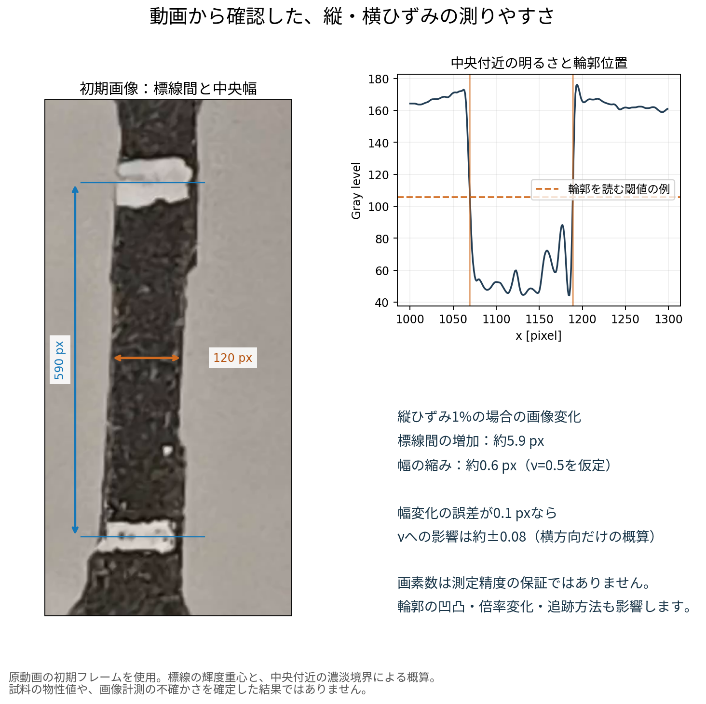

# 2026-11-06 引張試験動画：撮影状態の確認

25個の分割ファイルを順に結合し、7zから元のMP4を展開して確認しました。動画の再圧縮は行っていません。元動画は約524 MB・67.17秒です。ユーザー確認の条件は、標線間が「だいたい10 mm」、引張速度10 mm/minです。

**白い標線2本と試料の輪郭を認識でき、縦方向の伸びを追跡する候補になります。小ひずみ域のポアソン比をこの動画から精度よく算出できるかは、まだ確認できていません。撮影倍率を上げ、撮影条件を一定にすることを優先します。**

## 動画から確認できたこと

| 項目 | 確認内容 |
|---|---|
| 映像 | 記録解像度3840×2160、回転情報により縦向き2160×3840で表示 |
| 長さ・フレーム | 約67.17秒、4038フレーム、約60 fps |
| 標線 | 白い2本の帯が見える。初期画像で中心間は約590画素 |
| 試料幅 | 初期画像の中央付近で約120画素。測定位置・輪郭の決め方で変わる |
| 試験の様子 | 伸びる過程、終盤の遮蔽、破断後の状態を確認できる |
| 撮影条件 | 初期に画角の移動があり、後半は明るさ・色味も変化。ピント・倍率が一定だったことは確認できていない |
| 荷重との対応 | 今回の試験に対応する荷重CSVは未提供。別試験のCSVを代用していない |

[同じ図のPDF](initial_frame_review.pdf) / [時間ごとの一覧](contact_sheet.jpg)

## 縦ひずみと横ひずみで難しさが違う理由

初期画像の標線間約590画素、中央幅約120画素を使った比較です。

| 仮定した変形 | 画像上の変化の目安 |
|---|---:|
| 縦ひずみ1% | 標線間が約5.9画素増える |
| 同じ縦ひずみ1%、ポアソン比0.5 | 幅が約0.6画素縮む |

これは動画中のポアソン比を0.5と測定した結果ではありません。同じ縦ひずみでも、横方向では追跡すべき変化が小さいことを示す計算例です。

例えば、幅**変化**の誤差が0.1画素であれば、縦ひずみ1%でのポアソン比への影響は約±0.08です。これは横方向の誤差だけを考えた概算です。実際には初期幅、縦ひずみ、撮影倍率、面外変形などの誤差も入ります。サブピクセル処理を使っても、その誤差が自動的に0.1画素以下になるわけではありません。

縦方向も、標線が見えるだけで精度が保証されるわけではありません。小ひずみ域での標線間距離の繰返し性を確認する必要があります。

## 次の撮影で優先すること

1. **標線10 mmと上下の余白を中心に拡大する。** 現在は治具が画面を大きく占めています。初期の標線間は縦画面の約15%なので、まず約3〜4倍の光学的な撮影倍率を検討します。縦16〜20 mm程度の視野は検討の出発点で、実際の最短撮影距離・ピント・光学分解能で調整します。編集後の拡大やデジタルズームだけでは情報は増えません。
2. **スマホを固定し、レンズ・ピント・倍率・露出・ホワイトバランスを試験中に変えない。** 使用アプリで固定できる項目を確認します。照明も先に配置し、試験中に照射位置や強さを変更しません。現在の動画で生じた変化の原因が自動制御か手動操作かは、映像だけでは断定できません。
3. **白い標線の中心の決め方を固定する。** 今の標線は認識できますが、上下の境界が不均一です。「帯の上下端の中点」「輝度重心」など、追跡方法を決めて繰返し性を確認します。必要なら、薄く・均一で・材料に悪影響を与えない標線の付け方を予備試料で比較します。帯の太さだけからJIS不適合とは判定していません。
4. **幅は同じ材料位置を追う。** 輪郭に凹凸があり、場所によって読み取る幅が違います。画面の同じ高さだけを測り続けると、伸びにより別の材料位置を読んでしまいます。標線に対する位置を追跡し、試料軸に直角な幅を複数断面で評価する方法を検討します。平均化で系統誤差まで消えるとは考えません。
5. **静止動画を数秒残す。** 同じ設定で標線間距離・幅がどの程度ばらつくかを測ります。これは繰返し性の評価で、既知寸法・既知変位との照合による正確さの確認も別に必要です。

ポアソン比は、同じ動画内で縦ひずみと横ひずみを対応させて求められます。ヤング率には、今回の試験の荷重データと試験片ごとの初期断面積も必要です。今の映像に写る上側つかみはロードセル下流であり、その移動をCSVのクロスヘッド移動と厳密に同一と扱うには、荷重系のたわみ等を検証する必要があります。同期用の目印を追加する場合は、先に提案したクロスヘッド側の支持案を参照してください。

## 時刻の扱い

フレーム時刻の間隔は約14.18〜17.62 msで、中央値は約16.63 msでした。一律にフレーム番号を60で割ると、末尾で実際の表示時刻との差は約0.135秒になります。解析では元動画のフレーム時刻を使います。

## この確認で行った測定と限界

- 標線位置は初期画像の選択領域で明るさを平均し、帯内の重み付き中心から概算しました。幅は中央付近の濃淡境界から概算しました。標線中心や輪郭の追跡方法を確定したものではありません。
- 数値は元解像度の画素数です。掲載図を表示・拡大した画素数ではありません。
- 実寸スケールによる校正、静止時のばらつきの定量評価、全フレームの標線・幅の追跡、撮影倍率変化の補正は未実施です。
- ヤング率・ポアソン比・破断伸びは算出していません。破断直前に遮蔽があり、破断時刻も未確定です。
- この動画の確認だけでJIS適合や、治具に滑りがないことを証明してはいません。

[画素数・時刻の確認値（JSON）](review_measurements.json) / [初期画像の複数断面の輪郭計算（CSV）](first_frame_edge_measurements.csv)

元動画と分割ファイルは、容量が大きいため、このGitHubフォルダには含めていません。
