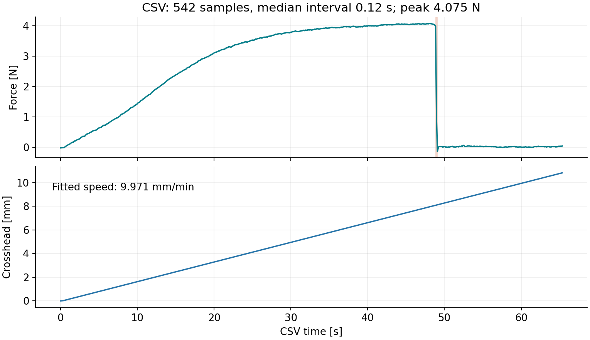
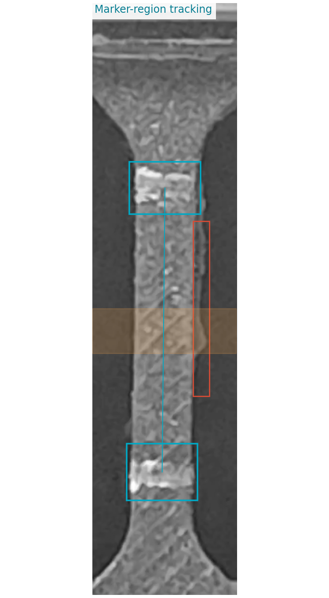
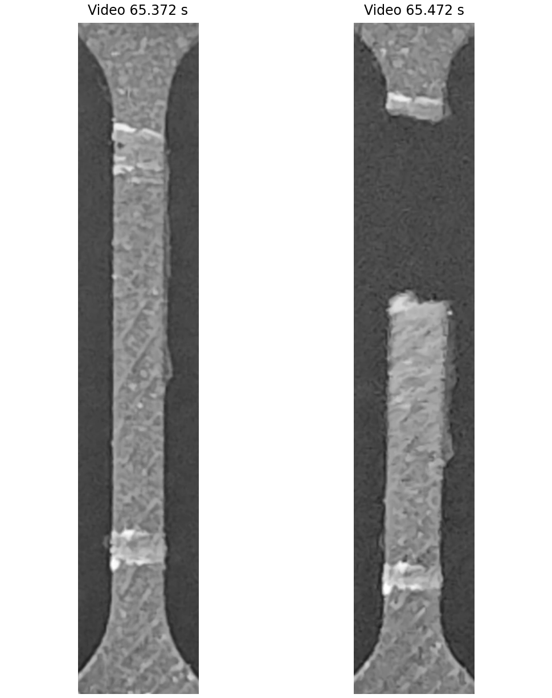
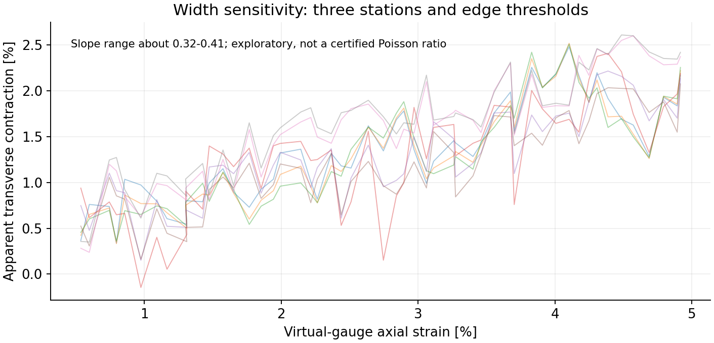

# 2026-11-10 引張試験：動画とCSVの予備評価

[確認レポートPDF（4ページ）](tensile_test_review_2026-11-10.pdf)

縦方向の伸びを画像から追跡できる見込みがあり、CSVには時刻・クロスヘッド移動量・荷重が記録されています。ヤング率・ポアソン比を確定するには、試験片寸法の実測、時刻同期、幅の画像計測精度をそろえる必要があります。

## 入力と確認できたこと

ユーザー提供の26分割7zを結合・展開した `VID_20261110_160901388.mp4` と `pme_test.csv` を確認しました。

| 項目 | 結果 |
|---|---|
| 動画 | 約69.38秒、4170フレーム、3840×2160、表示回転後は2160×3840 |
| 動画の時刻 | 元の表示時刻PTSを使用。フレーム番号÷60には置換していない |
| CSV | CP932、542行、約65.34秒、保存間隔中央値0.12秒 |
| 移動量からの速度 | 約9.97 mm/min |
| 記録上の最大荷重 | 約4.075 N、CSV時刻48.01秒 |
| 荷重急減 | CSV 48.85～48.97秒で大きく低下 |
| 可視の破断開口 | 動画65.37～65.47秒の間に確認 |
| 実寸法 | 未測定。型の幅2 mm・厚み1 mmは仮定値 |



## 画像の読み取り

標線周辺の2領域を元画像に直接照合するNCC法で追跡しました。6フレームごとに、回転補正後の元解像度から750×1950の領域を切り出し、実際のPTSを保持しています。試料の縁や標線が映る元動画を確認でき、破断も見えます。

今回の解析点は、白線付近に設定した**仮想標点**です。厳密に標準化した「標線の中心」の読取りとの照合はまだ行っていません。初期の2領域間距離は約600 px、中央の幅は約124 pxです。標線間隔を実測10 mmと確認した意味ではありません。

静止区間3～10秒では、仮想標点間距離の標準偏差が約0.17 px、中央幅の標準偏差が約0.50 pxでした。幅約124 px・縦ひずみ1％・ポアソン比0.5なら横収縮は約0.62 pxなので、1枚同士の比較による小ひずみのポアソン比には厳しい条件です。これは当該アルゴリズムの静止区間での揺れであり、測定全体の不確かさを保証する値ではありません。



試料の縁に細いバリ状の部分や凹凸が見えます。幅の測定では本体の輪郭と区別する必要があります。大ひずみ側の幅には抽出が不安定になる箇所があり、初期域の参考計算と分けて扱っています。

破断は上側の白い標線付近で生じています。塗料が原因とは断定できません。標線の太さ・塗膜、表面の傷、断面の状態を確認する箇所です。



## 同期用治具がない場合の時刻照合

破断と荷重急減を使うと、動画時刻－CSV時刻は概ね16.5秒です。可視グリップの運動開始を、静止区間を含む近似モデルから求める方法では約16.9秒でした。推定方法によって約0.4秒の差があります。運動モデル、荷重応答、画像追跡誤差も含むため、共通時計による精密な同期と同じものではありません。

次回は上流の可動点と固定点を同時に入れ、静止状態から記録してください。ポアソン比は動画内の縦・横ひずみから求めるので、CSVとの同期とは別に幅測定精度の確認が必要です。

## 参考試算：確定した材料物性値ではない

断面積を型寸法から **2 mm²と仮定**し、画像の仮想標点のひずみと暫定同期した荷重から求めた参考値です。実寸法、荷重校正、標線位置、同期精度は未確定です。

| 参考計算 | 結果と条件 |
|---|---|
| 応力－ひずみの直線の傾き | ひずみ0.5～2％、1～3％、2～5％の複数範囲で概ね7.7～8.2 MPa。断面積仮定に基づく |
| より大きい範囲 | 5～10％では約10.7～10.9 MPaとなり、評価する範囲の選択も必要 |
| 見かけのポアソン比 | 縦ひずみ0.5～5％で、幅の位置・輪郭しきい値を変えた8条件では約0.32～0.41 |

ポアソン比の値の幅は、統計的な信頼区間や真値の保証区間ではありません。3つの幅評価位置×3つの輪郭しきい値を試し、静止区間の幅の標準偏差が1 pxを超える1条件を図から除外しています（その条件は約4.05 pxで不安定）。全条件はデータに残しています。大ひずみ側の幅の急な跳びは輪郭抽出の不安定さを含み、材料の物理挙動と区別できません。



## 次回の優先事項

1. 試験前に、試験片ごとの幅と厚みを実測する。
2. 白い標線を細く均一に付け、縁のバリ・段差・傷を確認する。
3. 同期用の可動点と固定点を撮影し、同じ奥行きで縮尺を校正する。
4. 静止状態の動画と荷重データも残し、初期ひずみ域のデータ点数と、数N以下の低荷重域での測定精度を確認する。

[実験準備スケジュール](../tensile-test-preparation/README.md) / [同期目印ホルダの組立手順書](../../cad/tensile-sync-side-clamp-s50-m4x12/assembly-manual/README.md)

## データと再現方法

- [CSVの数値確認](data/csv_summary.json)
- [時刻照合](data/sync_summary.json)
- [画像追跡CSV](data/video_ncc_tracking.csv)
- [正規化した荷重CSV](data/force_data_utf8.csv)
- [幅の評価位置・しきい値による感度](data/width_sensitivity_summary.json)
- [断面積を仮定した傾きの参考試算](data/reference_modulus_sensitivity.json)
- [入力ファイルのハッシュ](data/input_provenance.json)

再解析には元動画の展開済みMP4と元CSV、FFmpeg、および `source/requirements.txt` のPython依存関係が必要です。座標・追跡領域は今回の動画専用です。

```sh
python source/analyze.py --video /path/to/VID_20261110_160901388.mp4 --csv /path/to/pme_test.csv --workdir /tmp/pme_video_review
```

元動画から標線周辺を切り出し、元テンプレートへの直接照合・局所的な拡大縮小・輪郭のしきい値の感度確認を行います。元のフレーム時刻を保持します。図は元フレームの切出し、計測領域の重ね書き、数値計算から作成しています。PDFは埋込み日本語テキスト・ページ数・配置・プレビューを確認しています。
