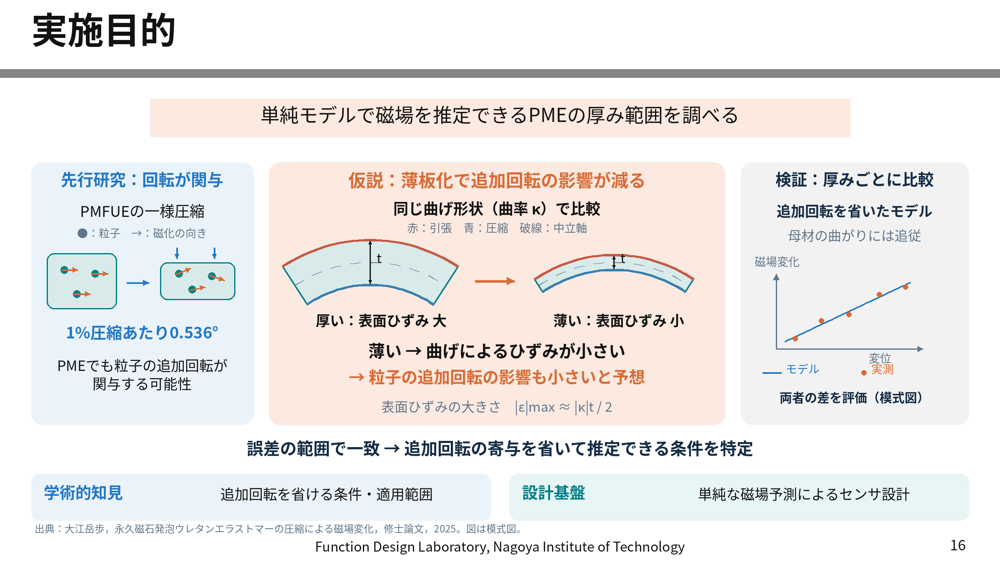

# 16ページ：薄板化で追加回転の影響が小さくなると考える理由

- [図形・文字を編集できるPowerPoint（1枚）](model_purpose_page16_editable.pptx)
- [16ページだけの確認用PDF](model_purpose_page16_preview.pdf)
- [添付資料の16ページを差し替えたPDF（全48ページ）](interim_review_page16_replaced.pdf)
- [説明原稿・力学的根拠・モデルの定義](model_purpose_page16_notes.md)

## 中央の仮説に追加した説明

**同じ曲げ形状（曲率）で比較 → 薄いほど曲げによる引張・圧縮ひずみが小さい → ひずみに伴う粒子の追加回転の影響も小さくなると予想**、という流れを厚い・薄い試料の比較図で示しました。

梁の曲げによる表面ひずみの大きさは `|ε|max ≈ |κ|t/2`（κ：曲率、t：厚さ）。同じκならtに比例します。赤を引張側、青を圧縮側、破線を中立軸とし、2つの試料は同じ中心線曲率で描いています。

ひずみが小さくなるという力学的根拠と、追加回転の磁場寄与も小さくなるという未検証の仮説を分けて記述しています。同じ荷重だけでは曲率が同じとは限りません。また、同じκで小さくなるのは表面ひずみと断面全体のひずみ差であり、厚さ方向のひずみ勾配κ自体ではありません。

## 省く回転の定義

ユーザー確認済みのモデルは、**磁化の向きが母材の曲がりに追従し、粒子単独の追加回転だけを省く**モデルです。母材の姿勢回転は薄板化しても消えないため、「薄ければ粒子が全く回転しない」という説明にはしていません。

添付資料17ページの説明に合わせています。35ページの「回転：回転無し」は、「回転：母材の回転に追従（粒子単独の追加回転は省略）」とすると解釈を揃えられます。今回の差し替え済みPDFで変更したのは16ページで、35ページの文言は元のままです。

先行研究の0.536°／1%圧縮は、添付資料24ページの別材料PMFUEの報告値です。PMEの曲げへの定量適用はしていません。比較グラフを含め図は模式図であり、既にモデルと実測が一致した結果ではありません。

## 編集と確認

PPTXには画像の埋め込みがなく、図形・線・矢印・テキストボックスを直接編集できます。グループ解除で個別に変更できます。元資料の白背景・黒見出し・灰色横線・研究室フッターに合わせ、大学ロゴは省いています。指定フォントは游ゴシックです。

PPTXの再読み込み・ZIP構造・画像ゼロ・文字の配置を確認し、プレビューも目視確認しています。PDFは共有する配置から別レンダラーで生成した画像ベースの確認版です。Microsoft PowerPointによる描画確認は実施していません。全48ページ版は、残り47ページの本文・ページ寸法と描画を元PDFと比較しています。詳細は[validation.json](validation.json)です。

再生成：`pip install -r source/requirements.txt` の環境で `python source/build_slide.py --source-pdf "中間審査会スライド_大橋怜倭.pdf"`。プレビュー用フォントはNoto Sans CJKを使用します。
